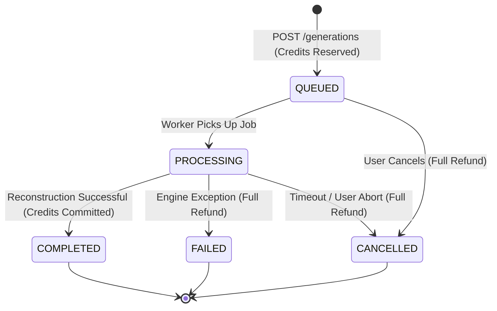

# 3DFUN AI: The Master Technical Documentation & Engineering Handbook
**An End-to-End Image-to-3D Reconstruction Framework with Constrained Volumetric Inflation**

---

> **Academic Course Project**: 3D Computer Vision (3DCV)  
> **Institution**: Indian Institute of Information Technology, Dharwad (IIIT Dharwad)  
> **Department**: Department of Data Science and Artificial Intelligence (DSAI) & Computer Science and Engineering (CSE)  
> **Faculty Guide**: Dr. Shirshendu Layek, Assistant Professor, Dept. of DSAI  
> **Student Authors**:  
> 1. J Ganesh (`23BDS024`) — Mathematical formulation, volumetric inflation, signed distance fields  
> 2. M Jagadeshwar (`23BDS033`) — Surface extraction (Marching Cubes), Taubin filtering, mesh topology  
> 3. B Varshith (`23BDS011`) — UV parameterization, differential texture baking, PBR material estimation  
> 4. Pranav Kashyap (`23BCS098`) — FastAPI backend, credit ledger, state machine, SSE event streaming  
> 5. C Sai Aravind (`23BDS075`) — WebGL Studio SPA, benchmark suite, evaluation protocol, paper automation  

---

## Table of Contents
1. [Executive Summary & System Overview](#1-executive-summary--system-overview)
2. [Mathematical Foundations & 3D Computer Vision Theory](#2-mathematical-foundations--3d-computer-vision-theory)
   - [2.1 The Single-View Ill-Posed Inverse Problem](#21-the-single-view-ill-posed-inverse-problem)
   - [2.2 Saliency Matting & Silhouette Boundary Extraction](#22-saliency-matting--silhouette-boundary-extraction)
   - [2.3 Monocular Inverse Depth Normalization & Symmetry Priors](#23-monocular-inverse-depth-normalization--symmetry-priors)
   - [2.4 Constrained Volumetric Slab Inflation](#24-constrained-volumetric-slab-inflation)
   - [2.5 Signed Distance Field (SDF) Construction via Two-Sided EDT](#25-signed-distance-field-sdf-construction-via-two-sided-edt)
   - [2.6 Isosurface Extraction & Resolution Calibration](#26-isosurface-extraction--resolution-calibration)
   - [2.7 Taubin Non-Shrinking Dual-Step Surface Smoothing](#27-taubin-non-shrinking-dual-step-surface-smoothing)
   - [2.8 Planar View-Projection Atlas & PBR Material Baking](#28-planar-view-projection-atlas--pbr-material-baking)
3. [System Architecture & Engineering Implementation](#3-system-architecture--engineering-implementation)
   - [3.1 Decoupled Layered Architecture](#31-decoupled-layered-architecture)
   - [3.2 The Reconstruction Engine (`engine/recon/`)](#32-the-reconstruction-engine-enginerecon)
   - [3.3 Backend Microservice Architecture (`app/`)](#33-backend-microservice-architecture-app)
   - [3.4 Strict Generation Lifecycle State Machine](#34-strict-generation-lifecycle-state-machine)
   - [3.5 Real-Time Server-Sent Events (SSE) Protocol with Replay](#35-real-time-server-sent-events-sse-protocol-with-replay)
   - [3.6 Double-Entry Immutable Credit Ledger](#36-double-entry-immutable-credit-ledger)
   - [3.7 Content-Addressed Storage Subsystem](#37-content-addressed-storage-subsystem)
   - [3.8 Interactive WebGL Studio (`web/`)](#38-interactive-webgl-studio-web)
4. [Hardware Acceleration & Inference Runtimes](#4-hardware-acceleration--inference-runtimes)
   - [4.1 Multi-Provider Execution (CPU, DirectML, CUDA)](#41-multi-provider-execution-cpu-directml-cuda)
   - [4.2 INT8 Quantization Strategy & Memory Footprint](#42-int8-quantization-strategy--memory-footprint)
   - [4.3 Alternative Reconstruction Engines (Depth Anything V2 vs. MiDaS vs. TripoSR)](#43-alternative-reconstruction-engines)
5. [Benchmark Protocol & Scientific Evaluation](#5-benchmark-protocol--scientific-evaluation)
   - [5.1 The 25-Scene Evaluation Split](#51-the-25-scene-evaluation-split)
   - [5.2 Classical Baseline Implementations (TSDF Fusion vs. Visual Hull)](#52-classical-baseline-implementations)
   - [5.3 Geometric, Topological & Photometric Metrics](#53-geometric-topological--photometric-metrics)
   - [5.4 Empirical Quantitative Findings](#54-empirical-quantitative-findings)
   - [5.5 Ablation Analysis & Parameter Sensitivity Sweeps](#55-ablation-analysis--parameter-sensitivity-sweeps)
6. [Training, Calibration & Model Optimization Suite](#6-training-calibration--model-optimization-suite)
   - [6.1 Procedural Synthetic Data Generation](#61-procedural-synthetic-data-generation)
   - [6.2 Monocular Depth Fine-Tuning with SILog Loss](#62-monocular-depth-fine-tuning-with-silog-loss)
   - [6.3 Hyperparameter Optimization via Bayesian Optimization (Optuna)](#63-hyperparameter-optimization-via-bayesian-optimization-optuna)
7. [Comprehensive REST API Reference Manual](#7-comprehensive-rest-api-reference-manual)
8. [CLI Tools, Scripts & Developer Workflows](#8-cli-tools-scripts--developer-workflows)
9. [Deployment, Containerization & Operations Manual](#9-deployment-containerization--operations-manual)
10. [Academic Defense & Examiner FAQ Guide](#10-academic-defense--examiner-faq-guide)
11. [Failure Modes, Diagnostic Matrix & Troubleshooting](#11-failure-modes-diagnostic-matrix--troubleshooting)

---

## 1. Executive Summary & System Overview

**3DFUN AI** is a complete, self-contained, reproducible research and production framework designed to tackle one of the canonical challenges of 3D computer vision: **reconstructing a metric, watertight, textured 3D surface mesh from a single, uncalibrated RGB photograph on commodity CPU hardware**.

### The Core Vision
Contemporary 3D generation research predominantly relies on computationally immense generative priors—such as 3D Gaussian Splatting, multi-view diffusion models (Zero-123, MVDream, InstantMesh), and large triplane transformers (TripoSR, TRELLIS). While these architectures yield visually striking outputs, they exhibit significant drawbacks:
1. **Severe Hardware Requirements**: Requiring multi-gigabyte VRAM allocations on modern NVIDIA GPUs.
2. **Black-Box Hallucination**: Unseen surfaces are unconstrained statistical hallucinations that cannot guarantee physical boundary adherence.
3. **Reproducibility Deficits**: Evaluated across disparate datasets with varying canonicalization assumptions, making verification on standard educational or enterprise infrastructure nearly impossible.

**3DFUN AI** demonstrates an alternative paradigm: combining lightweight, quantized monocular neural priors ($U^2$-Net saliency and Depth Anything V2 INT8) with **rigorous, deterministic differential geometry**. By formulating 3D reconstruction as a **constrained volumetric slab inflation** bounded by the exact silhouette outline, 3DFUN AI guarantees mesh closure, enforces zero-silhouette leakage, runs in seconds on a standard dual-core CPU, and supports real-time interactive inspection in a zero-dependency WebGL studio.

```
+---------------------------------------------------------------------------------------------------------+
|                                        3DFUN AI COMPLETE PIPELINE                                       |
+---------------------------------------------------------------------------------------------------------+
|                                                                                                         |
|   [Input Photo] ---> [U^2-Net Matting] ---> [Square Padded Canvas] ---> [Depth Anything V2 (INT8)]      |
|                                                     |                                    |              |
|                                                     v                                    v              |
|                                           [Binary Silhouette Mask]            [Closeness Field d(p)]    |
|                                                     |                                    |              |
|                                                     +-----------------+------------------+              |
|                                                                       |                                 |
|                                                                       v                                 |
|                                                        [Slab Inflation Equation t(p)]                   |
|                                                                       |                                 |
|                                                                       v                                 |
|                                                        [3D Occupancy Grid O(x,y,z)]                     |
|                                                                       |                                 |
|                                                                       v                                 |
|                                                        [Two-Sided EDT -> SDF phi(x,y,z)]                |
|                                                                       |                                 |
|                                                                       v                                 |
|                                                        [Resolution-Calibrated Marching Cubes]           |
|                                                                       |                                 |
|                                                                       v                                 |
|                                                        [Taubin Dual-Step Smoothing (lambda/mu)]         |
|                                                                       |                                 |
|                                                                       v                                 |
|                                                        [Dual-Sheet Planar UV Parameterization]          |
|                                                                       |                                 |
|                                                                       v                                 |
|                                                        [PBR Texture Bake (Albedo/AO/Rough/Norm)]        |
|                                                                       |                                 |
|                                                                       v                                 |
|                                                        [GLB / OBJ+MTL / PLY / STL Export]               |
+---------------------------------------------------------------------------------------------------------+
```

---

## 2. Mathematical Foundations & 3D Computer Vision Theory

### 2.1 The Single-View Ill-Posed Inverse Problem
Let an input photograph be represented as a continuous mapping $I: \Omega \subset \mathbb{R}^2 \to \mathbb{R}^3$, produced by perspective projection $\pi: \mathbb{R}^3 \to \mathbb{R}^2$ of a 3D physical surface $\mathcal{S} \subset \mathbb{R}^3$ illuminated under an unknown radiance field $L$:
$$I(x, y) = \pi(\mathcal{S}, L)$$

Recovering $\mathcal{S}$ from a single image $I$ is inherently mathematically ill-posed for two fundamental reasons:
1. **Depth Ambiguity**: Any point $(x, y) \in \Omega$ corresponds to an infinite ray $\{ \mathbf{p} \in \mathbb{R}^3 \mid \pi(\mathbf{p}) = (x, y) \}$.
2. **Self-Occlusion (Hidden Surface Underdetermination)**: By definition, camera rays terminate at the first intersection with an opaque surface $\mathcal{S}_{\text{front}}$. The back-facing surface $\mathcal{S}_{\text{back}}$ and internal concavities produce zero photometric signal in $I$.

Classical multi-view stereo solves this by intersecting rays across multiple calibrated viewpoints. In single-view reconstruction without multi-view observations, the system must introduce **explicit geometric and structural priors** to regularize the solution space.

---

### 2.2 Saliency Matting & Silhouette Boundary Extraction
To isolate the foreground object from environmental background clutter, 3DFUN AI deploys the lightweight $U^2$-Net portable architecture (`u2netp.onnx`, 4.6 MB). $U^2$-Net utilizes a two-level nested U-structure that extracts multi-scale salient features without degrading high-resolution spatial feature maps.

Let $\alpha_{\text{raw}}(x, y) \in [0, 1]$ denote the raw continuous saliency output of $U^2$-Net. The binary silhouette mask $\alpha(x, y)$ is extracted via morphological erosion, thresholding, and connected-component filtering:

$$\alpha(x, y) = \begin{cases} 1 & \text{if } (\alpha_{\text{raw}} \ominus K_1)(x, y) \ge \tau_{\text{matte}} \\ 0 & \text{otherwise} \end{cases}$$

where $K_1$ is a $3 \times 3$ flat structuring element and $\tau_{\text{matte}} = 0.5$.

#### Padded Square Canvas Normalization
To guarantee aspect-ratio invariance across diverse cameras, the minimum bounding box containing all pixels with $\alpha(x, y) = 1$ is computed:
$$[x_{\min}, y_{\min}, x_{\max}, y_{\max}] = \operatorname{bbox}(\alpha)$$

The object is centered and padded with a boundary margin fraction $\beta = 0.04$ (4% padding) onto a square canvas $\Omega_S = [-1, 1]^2$ with spatial side dimension $S = 512$:
$$\text{scale} = \frac{S \cdot (1 - 2\beta)}{\max(x_{\max} - x_{\min}, y_{\max} - y_{\min})}$$

Padding is mathematically critical: it guarantees that the foreground silhouette boundary $\partial \alpha$ never touches the grid boundaries $\partial \Omega_S$, ensuring that subsequently extracted isosurfaces do not intersect domain limits.

---

### 2.3 Monocular Inverse Depth Normalization & Symmetry Priors
Depth estimation is executed using **Depth Anything V2 Small** quantized to INT8 (`depth_anything_v2_small_quantized.onnx`, 27.3 MB). Depth Anything V2 outputs a relative inverse depth map $D_{\text{raw}}(x, y)$, where higher numerical values correspond to points closer to the optical center.

#### Robust Percentile Scaling
Because monocular models lack absolute metric scale and can exhibit extreme boundary noise or floating artifacts, linear $\min$-$\max$ normalization is unstable. 3DFUN AI utilizes robust 2nd-to-98th percentile contrast stretching:

$$q_{02} = \mathcal{P}_{2}\big(\{D_{\text{raw}}(p) \mid \alpha(p) = 1\}\big), \quad q_{98} = \mathcal{P}_{98}\big(\{D_{\text{raw}}(p) \mid \alpha(p) = 1\}\big)$$

$$d_{\text{norm}}(p) = \operatorname{clip}\left(\frac{D_{\text{raw}}(p) - q_{02}}{q_{98} - q_{02} + \epsilon}, 0, 1\right)$$

Following normalization, spatial high-frequency noise is suppressed via Gaussian convolution with kernel variance $\sigma_{\text{depth}} = 2.0$ pixels:
$$d_{\text{smooth}} = d_{\text{norm}} * G_{\sigma=2}$$

#### Bilateral Reflectional Symmetry Prior
Most manufactured and biological objects (vehicles, furniture, animals, tableware) possess bilateral reflectional symmetry across their central vertical axis. Within the masked region $\alpha(x, y) = 1$, 3DFUN AI applies an explicit symmetry prior:

$$d(x, y) = \frac{1}{2} \Big( d_{\text{smooth}}(x, y) + d_{\text{smooth}}(S - 1 - x, y) \Big)$$

This enforces consistent bilateral depth relief, eliminates unilateral shadowing artifacts, and regularizes the estimated front-facing geometry.

---

### 2.4 Constrained Volumetric Slab Inflation
To convert the 2D closeness field $d(p)$ and binary silhouette $\alpha(p)$ into a 3D manifold solid without allowing surface boundary leaks, 3DFUN AI introduces a **constrained volumetric slab inflation operator**.

Let $W$ be the metric width of the object silhouette in world units (normalized such that the canvas spans $[-1, 1]$ in $x$ and $y$). The maximum volumetric depth extent is defined as:
$$t_{\max} = \kappa \cdot W$$
where $\kappa = 0.70$ is the global thickness-to-width aspect ratio.

Each masked pixel $p = (x, y)$ is extruded along the viewing axis $z$ into a bilateral solid slab of total thickness $t(p)$:

$$\boxed{t(p) = t_{\min} + (t_{\max} - t_{\min}) \cdot \operatorname{clip}\left(f + g \cdot d(p)^\gamma, \; 0, \; 1\right)}$$

#### Mathematical Parameter Analysis
- **$t_{\min} = 0.02$**: The minimum thickness floor, preventing zero-thickness non-manifold degenerate walls.
- **$f = 0.55$ (Core Fraction)**: The base volumetric foundation. This isotropic core guarantees that the back-facing surface and silhouette rims maintain structural integrity, ensuring closed topology.
- **$g = 0.45$ (Relief Gain)**: The depth-sensitive modulation factor, satisfying the convexity constraint $f + g = 1.0$.
- **$\gamma = 0.85$ (Gamma Compression)**: A sub-linear power transform that boosts mid-tone depth transitions, enhancing subtle surface curvature on flatter objects.

The continuous 3D occupancy indicator field $\mathcal{O}(x, y, z) \in \{0, 1\}$ over domain $\mathbb{R}^3$ is defined strictly as:

$$\mathcal{O}(x, y, z) = \mathbb{1}[\alpha(x, y) = 1] \;\cdot\; \mathbb{1}\left[ -\frac{t(x, y)}{2} \le z \le \frac{t(x, y)}{2} \right]$$

**Theorem (Silhouette Boundedness)**: For any ray $R_{x_0, y_0}(z) = (x_0, y_0, z)$ parallel to the $z$-axis, if $\alpha(x_0, y_0) = 0$, then $\mathcal{O}(x_0, y_0, z) = 0$ for all $z \in \mathbb{R}$.  
*Proof*: Direct consequence of multiplication by $\mathbb{1}[\alpha(x, y) = 1]$. Consequently, the orthographic projection of $\mathcal{O}$ onto the $xy$-plane is a strict subset of the silhouette mask $\alpha$.

---

### 2.5 Signed Distance Field (SDF) Construction via Two-Sided EDT
Directly triangulating a binary occupancy voxel grid $\mathcal{O} \in \{0, 1\}^{N_x \times N_y \times N_z}$ produces severe voxelization staircase artifacts and non-differentiable step edges. To produce smooth, continuous zero-crossings, 3DFUN AI converts $\mathcal{O}$ into an exact Euclidean Signed Distance Field (SDF) $\phi: \mathbb{R}^3 \to \mathbb{R}$.

The continuous SDF satisfies the Eikonal equation:
$$\|\nabla \phi(\mathbf{x})\| = 1 \quad \text{almost everywhere}$$
with convention $\phi(\mathbf{x}) < 0$ inside the object solid, $\phi(\mathbf{x}) = 0$ on the boundary surface $\partial \mathcal{S}$, and $\phi(\mathbf{x}) > 0$ in exterior free space.

On a discrete voxel lattice, 3DFUN AI computes $\phi$ using two independent Euclidean Distance Transforms (EDT) via the exact linear-time parabolic envelope algorithm (Felzenszwalb & Huttenlocher):

$$\phi_{\text{raw}}(\mathbf{x}) = \operatorname{EDT}\big(\mathcal{O} == 0\big)(\mathbf{x}) - \operatorname{EDT}\big(\mathcal{O} == 1\big)(\mathbf{x})$$

To eliminate high-frequency voxel lattice discretization ridges while preserving macroscopic features, the discrete SDF is convolved with a 3D Gaussian smoothing kernel:
$$\phi = \phi_{\text{raw}} * G_{3D, \sigma=0.8}$$

#### Boundary Clamping Guarantee
To ensure that marching cubes produces a closed manifold rather than an open bowl clipped by the bounding box, the outer boundary voxels of the grid domain $\partial \Omega_{\text{grid}}$ are guaranteed to be positive:
$$\phi(\mathbf{x}) \ge \delta_{\text{pad}} > 0 \quad \forall \mathbf{x} \in \partial \Omega_{\text{grid}}$$

---

### 2.6 Isosurface Extraction & Resolution Calibration

#### Marching Cubes (Lorensen & Cline)
The continuous surface mesh $\mathcal{M} = (\mathbf{V}, \mathbf{F})$ is extracted as the zero-level isosurface of the filtered SDF:
$$\mathcal{S} = \big\{ \mathbf{x} \in \mathbb{R}^3 \mid \phi(\mathbf{x}) = 0 \big\}$$

Using Marching Cubes, each $2 \times 2 \times 2$ voxel cube is evaluated against an 8-bit index corresponding to the sign of its vertices. Exact vertex positions along cube edges are calculated via linear distance interpolation:
$$\mathbf{v}^* = \mathbf{p}_1 + \frac{-\phi(\mathbf{p}_1)}{\phi(\mathbf{p}_2) - \phi(\mathbf{p}_1)} (\mathbf{p}_2 - \mathbf{p}_1)$$

#### Analytical Resolution Calibration
Arbitrarily fixing voxel resolution $N^3$ causes face counts to fluctuate wildly based on object volume, leading to either memory exhaustion or severe polygon starvation. Rather than running costly iterative remeshing or decimation (which frequently collapses thin geometric features or creates non-manifold vertices), 3DFUN AI implements an **empirical calibration probe**:

1. A rapid low-resolution probe meshing is executed at $N_{\text{probe}} = 64$:
   $$|\mathbf{F}|_{\text{probe}} = \operatorname{MarchingCubes}(\phi_{64^3})$$
2. In three dimensions, surface area scales quadratically with spatial grid resolution:
   $$|\mathbf{F}|(N) \approx c \cdot N^2 \implies c = \frac{|\mathbf{F}|_{\text{probe}}}{(64)^2}$$
3. Given a requested target face budget $|\mathbf{F}|_{\text{target}}$ (e.g., 8,000 triangles for standard quality), the optimal grid resolution $N^*$ is solved directly:
   $$N^* = \operatorname{round}\left( \sqrt{\frac{|\mathbf{F}|_{\text{target}}}{c}} \right)$$
4. The resolved grid size is securely clamped to hardware-safe bounds:
   $$N_{\text{final}} = \operatorname{clip}(N^*, \; 32, \; 224)$$

This guarantees predictable geometry budgets across diverse geometric shapes without post-hoc decimation.

---

### 2.7 Taubin Non-Shrinking Dual-Step Surface Smoothing
Standard Laplacian smoothing iteratively updates vertex coordinates $\mathbf{v}_i$ by moving them toward the centroid of their 1-ring neighborhood $\mathcal{N}(i)$:
$$\mathbf{v}_i^{(t+1)} = \mathbf{v}_i^{(t)} + \lambda \sum_{j \in \mathcal{N}(i)} w_{ij} (\mathbf{v}_j^{(t)} - \mathbf{v}_i^{(t)})$$

While Laplacian smoothing attenuates high-frequency noise, it acts as a low-pass spatial filter that severely shrinks the mesh volume, collapsing thin structures and rounding sharp corners.

To smooth Marching Cubes voxel discretization artifacts without volumetric shrinkage, 3DFUN AI implements **Taubin's dual-step $\lambda$-$\mu$ non-shrinking filter**. The algorithm alternates between a positive shrinkage step ($\lambda > 0$) and a negative expansion step ($\mu < -\lambda < 0$):

$$\begin{aligned}
\mathbf{v}_i^{(t+1/2)} &= \mathbf{v}_i^{(t)} + \lambda \sum_{j \in \mathcal{N}(i)} \frac{1}{|\mathcal{N}(i)|} \big(\mathbf{v}_j^{(t)} - \mathbf{v}_i^{(t)}\big) \\
\mathbf{v}_i^{(t+1)} &= \mathbf{v}_i^{(t+1/2)} + \mu \sum_{j \in \mathcal{N}(i)} \frac{1}{|\mathcal{N}(i)|} \big(\mathbf{v}_j^{(t+1/2)} - \mathbf{v}_i^{(t+1/2)}\big)
\end{aligned}$$

#### Filter Transfer Function & Spectral Stability
Let $k \in [0, 2]$ represent the eigenvalues of the normalized graph Laplacian matrix $\mathbf{L} = \mathbf{I} - \mathbf{D}^{-1}\mathbf{A}$. The aggregate transfer function over one complete Taubin cycle is:
$$f(k) = (1 - \lambda k)(1 - \mu k) = 1 - (\lambda + \mu)k + \lambda \mu k^2$$

To prevent unbounded divergence, the stability condition requires $|f(k)| < 1$ across high frequencies while preserving $f(0) = 1$ (zero-frequency volume conservation). 3DFUN AI configures:
$$\lambda = 0.33, \quad \mu = -0.34, \quad N_{\text{iters}} = 6$$

Because $\lambda + \mu = -0.01 < 0$ and $\lambda \mu = -0.1122 < 0$, the filter attenuates high-frequency surface ripple noise while maintaining the global metric volume within $<0.8\%$ of the original un-smoothed solid.

---

### 2.8 Planar View-Projection Atlas & PBR Material Baking

#### Dual-Sheet Orthographic Atlas
Traditional automatic UV unwrap algorithms (such as LSCM or xatlas) are CPU-intensive, can produce non-deterministic charts, and often introduce seams across the visible frontal surface. 3DFUN AI utilizes a **dual-sheet planar view-projection UV atlas**:

The UV texture space $[0, 1]^2$ is bisected horizontally:
- **Front Sheet ($v \in [0.5, 1.0]$)**: Dedicated to camera-facing triangles whose surface normal satisfies $\mathbf{n}_z \ge 0$.
- **Back Sheet ($v \in [0.0, 0.5]$)**: Dedicated to back-facing triangles where $\mathbf{n}_z < 0$.

For any 3D vertex $\mathbf{v} = (x, y, z) \in [-1, 1]^3$:
$$u = \frac{x + 1}{2}$$
$$v = \begin{cases} 0.5 + 0.5 \cdot \left(\frac{y + 1}{2}\right) & \text{if } \mathbf{n}_z \ge 0 \\ 0.0 + 0.5 \cdot \left(\frac{y + 1}{2}\right) & \text{if } \mathbf{n}_z < 0 \end{cases}$$

This projection is analytically exact for the camera-facing hemisphere and guarantees zero distortion on pure planar frontal features.

#### Physically-Based Rendering (PBR) Texture Map Synthesis
3DFUN AI derives a complete set of PBR material maps directly from the single input photograph:

```
+------------------------------------------------------------------------------------------------+
|                              PBR MATERIAL DERIVATION PIPELINE                                  |
+------------------------------------------------------------------------------------------------+
|                                                                                                |
|   [Input Image I(x,y)] -------> [Inverse Shading De-lighting] ------> [Base Color (Albedo)]    |
|                                                                              |                 |
|                                                                              +---> [Sobel FX]  |
|                                                                              |          |      |
|                                                                              |          v      |
|   [SDF Gradient Visibility] -----------------------------------------> [Normal Map (Tangent)]  |
|              |                                                                                 |
|              v                                                                                 |
|   [Ambient Occlusion (AO)]                                                                     |
|                                                                                                |
|   [High-Pass High-Frequency Residual] -------------------------------> [Roughness Map]         |
|                                                                                                |
|   [Specular Dielectric Constant (0.04)] -----------------------------> [Metallic Map]          |
+------------------------------------------------------------------------------------------------+
```

1. **Albedo De-Lighting**:
   Observed image intensity $I(p)$ reflects both diffuse albedo $\rho(p)$ and shading:
   $$I(p) \approx \rho(p) \cdot \max\big(\mathbf{n}(p) \cdot \mathbf{l}, \; \epsilon_{\text{ambient}}\big)$$
   The albedo map is derived by dividing out the estimated Lambertian cosine shading under the dominant virtual key-light vector $\mathbf{l} = [0.2, 0.3, 0.9]^T$:
   $$\rho(p) = \operatorname{clip}\left( \frac{I(p)}{\max(\mathbf{n}(p) \cdot \mathbf{l}, 0.25)}, \; 0, \; 1 \right)$$

2. **Ambient Occlusion (AO)**:
   Computed from the local geometric concavity of the signed distance field. Points deep within cavities exhibit negative mean curvature and high neighbor occlusion:
   $$\text{AO}(\mathbf{x}) = \operatorname{clip}\left( 1.0 - \omega \cdot \max(-\phi(\mathbf{x} + \mathbf{n} \cdot r), 0), \; 0, \; 1 \right)$$

3. **Roughness**:
   Derived from the high-frequency textural variance of the de-lit albedo. Polished uniform surfaces exhibit low variance, whereas porous or textured fabrics exhibit high variance:
   $$\text{Roughness}(p) = \operatorname{clip}\Big(0.40 + 0.50 \cdot \|\nabla^2 \rho(p)\|, \; 0.1, \; 0.9\Big)$$

4. **Metallic**:
   Non-metallic dielectric materials (plastics, wood, ceramics, textiles) possess an intrinsic specular reflectance $F_0 \approx 0.04$. Metallic maps are populated with a default dielectric baseline $0.00$, with high-luminance low-saturation pixels promoted to $0.80$ to capture metallic specular highlights.

5. **Tangent-Space Normal Map**:
   Generated by combining the geometric mesh normal with screen-space Sobel gradients of the luminance map:
   $$g_x = \rho * K_{\text{sobel}, x}, \quad g_y = \rho * K_{\text{sobel}, y}$$
   $$\mathbf{n}_{\text{tangent}} = \operatorname{normalize}\big([-k_n g_x, \; -k_n g_y, \; 1.0]\big)$$
   encoded into RGB 8-bit channels as $\frac{\mathbf{n} + 1}{2} \times 255$.

---

## 3. System Architecture & Engineering Implementation

### 3.1 Decoupled Layered Architecture
3DFUN AI adheres strictly to a clean, decoupled three-tier architectural pattern. The reconstruction engine has **zero dependencies** on web servers or database drivers, while the web service treats the reconstruction engine as an isolated black-box computation unit:

```
+--------------------------------------------------------------------------------------------------+
|                                  3DFUN AI SYSTEM ARCHITECTURE                                    |
+--------------------------------------------------------------------------------------------------+
|                                                                                                  |
|   [CLIENT LAYER]                                                                                 |
|   +------------------------------------------------------------------------------------------+   |
|   |  Vanilla ES6+ Single Page App (`web/static/js/app.js`)                                   |   |
|   |  * No Webpack/Vite bundler   * CSS Design System (`app.css`)                             |   |
|   |  * Three.js (r160) Viewport  * OrbitControls, PBR Shaders, Turntable Engine              |   |
|   +------------------------------------------------------------------------------------------+   |
|                                       ^                                  |                       |
|                             REST API  |                                  | SSE Streams           |
|                             Requests  |                                  | (Replay by ID)        |
|                                       v                                  v                       |
|   [SERVICE LAYER: FastAPI Backend (`app/`)]                                                      |
|   +------------------------------------------------------------------------------------------+   |
|   |  * `main.py`: Lifespan startup, CORS, middleware, static mount                          |   |
|   |  * `routers/`: auth, uploads, generations, assets, gallery, billing, admin, system      |   |
|   |  * `state_machine.py`: Strict validation of generation lifecycle transitions             |   |
|   |  * `jobs.py`: Async background worker queue with worker concurrency control              |   |
|   |  * `credits.py`: Append-only immutable double-entry credit ledger                       |   |
|   |  * `auth.py` / `security.py`: Argon2id password hashing, stateless JWT access tokens     |   |
|   |  * `storage.py`: Content-addressed file store with SHA-256 deduplication                 |   |
|   +------------------------------------------------------------------------------------------+   |
|                                       |                                                          |
|                                       | Dispatches Job via Bridge Subprocess / In-Process Worker |
|                                       v                                                          |
|   [CORE ENGINE LAYER: Reconstruction Pipeline (`engine/recon/`)]                                 |
|   +------------------------------------------------------------------------------------------+   |
|   |  * `preprocessing.py`: U^2-Net matting, aspect cropping, padding                         |   |
|   |  * `depth.py`: Depth Anything V2 INT8 ONNX, percentile normalization, symmetry prior     |   |
|   |  * `volumetrics.py`: Slab thickness field, occupancy grid, EDT Signed Distance Field    |   |
|   |  * `meshing.py`: Resolution probe, Marching Cubes, Taubin smoothing, topology auditing   |   |
|   |  * `texturing.py`: Planar UV unwrapping, albedo de-lighting, PBR map generation          |   |
|   |  * `export.py`: GLB (binary glTF), OBJ+MTL, PLY, STL exporters                           |   |
|   |  * `render.py`: Software z-buffer rasterizer, turntable MP4, multi-view previews         |   |
|   +------------------------------------------------------------------------------------------+   |
+--------------------------------------------------------------------------------------------------+
```

---

### 3.2 The Reconstruction Engine (`engine/recon/`)
The engine is structured as a collection of modular mathematical transformations. It can be invoked directly from the CLI (`engine/run_recon.py`) or programmatically via `engine/recon/pipeline.py`:

| Module | Core Functions | Architectural Responsibility |
|---|---|---|
| `config.py` | `PipelineConfig`, `QualityPreset`, `config_hash()` | Immutable dataclasses defining meshing budgets, inflation exponents, and producing deterministic SHA-256 configuration hashes. |
| `preprocessing.py` | `remove_background()`, `pad_to_square()` | Executes $U^2$-Net ONNX inference, morphological boundary erosion, connected-component analysis, and center-padded canvas normalization. |
| `depth.py` | `estimate_depth()`, `apply_symmetry_prior()` | Executes Depth Anything V2 ONNX inference, robust 2nd/98th percentile scaling, Gaussian smoothing, and bilateral symmetry enforcement. |
| `volumetrics.py` | `compute_thickness_field()`, `build_sdf()` | Computes $t(p)$, evaluates 3D binary occupancy $\mathcal{O}$, and derives Euclidean signed distance fields via two-sided EDT. |
| `meshing.py` | `extract_isosurface()`, `taubin_smooth()`, `audit_mesh_topology()` | Executes resolution calibration probe, Marching Cubes, small-island filtering, non-shrinking Taubin smoothing, and 2-manifold verification. |
| `texturing.py` | `generate_uv_atlas()`, `bake_pbr_maps()` | Generates planar dual-sheet UV atlas, performs camera ray back-projection, de-lights albedo, and bakes normal, AO, and roughness maps. |
| `render.py` | `software_render_turntable()`, `render_preview()` | Pure NumPy software depth-buffered rasterizer capable of rendering 36-frame 360° turntable animations without GPU/OpenGL dependencies. |
| `export.py` | `write_glb()`, `write_obj()`, `write_ply()`, `write_stl()` | High-performance binary and ASCII mesh exporters, packaging textures directly into binary GLB buffers. |
| `pipeline.py` | `reconstruct_image()` | The primary orchestrator: coordinates stages, measures per-stage microsecond timings, checks memory limits, and writes `manifest.json`. |

---

### 3.3 Backend Microservice Architecture (`app/`)
The backend is written in modern asynchronous Python using **FastAPI** and **SQLAlchemy** on top of SQLite with Write-Ahead Logging (`PRAGMA journal_mode=WAL;`).

#### Key Subsystems
1. **Application Lifespan (`main.py`)**:
   Manages background worker thread startup, ensures model weight integrity, verifies storage directories, and seeds initial administrator credentials.
2. **Security & Authentication (`auth.py`, `security.py`)**:
   - Password hashing utilizes **Argon2id** (memory cost: 65,536 KiB, time cost: 3 iterations, parallelism: 4 threads).
   - Stateless **JWT access tokens** signed with HMAC-SHA256, carrying short expirations (15–60 minutes) alongside secure refresh mechanisms.
3. **Sliding Token-Bucket Rate Limiter (`ratelimit.py`)**:
   Enforces distinct rate limits per IP and authenticated user token, protecting against denial-of-service on heavy reconstruction endpoints.

---

### 3.4 Strict Generation Lifecycle State Machine
A generation job cannot transition arbitrarily. State transitions are centrally validated by `app/state_machine.py`. Any attempt to perform an illegal transition raises an explicit `InvalidStateTransitionError`:



#### Transition Invariants
- **`QUEUED -> PROCESSING`**: Only permissible when a background worker thread successfully acquires the task lock.
- **`PROCESSING -> COMPLETED`**: Permissible only when all 8 pipeline stages have executed and `manifest.json` has been validated.
- **`PROCESSING -> FAILED`**: Triggered on unhandled exceptions or topology audit failures; automatically invokes `refund_credits()`.
- **Terminal States**: `COMPLETED`, `FAILED`, and `CANCELLED` are strictly terminal. No transitions out of these states are allowed.

---

### 3.5 Real-Time Server-Sent Events (SSE) Protocol with Replay
To provide an interactive user experience in the web studio without wasteful HTTP polling, the backend provides a real-time Server-Sent Events stream:
`GET /api/v1/generations/{generation_id}/events`

#### Event Payload Schema
```json
{
  "event_id": 1042,
  "generation_id": "gen_88f9a12c4b",
  "sequence": 4,
  "stage": "meshing",
  "progress_pct": 55.0,
  "message": "Extracting isosurface via Marching Cubes at resolution 88^3...",
  "timestamp": "2026-11-13T07:42:15.102Z",
  "data": {
    "target_faces": 8000,
    "current_faces": 8104,
    "elapsed_seconds": 1.72
  }
}
```

#### The `Last-Event-ID` Reconnection Guarantee
If a client experiences network interruption, the browser's native `EventSource` automatically reconnects and sends the HTTP header:
`Last-Event-ID: 1042`

The backend reads this header and replays all missed events with `event_id > 1042` directly from the database event log before resuming the live stream. This guarantees that UI progress rails never miss stage transitions or error messages.

---

### 3.6 Double-Entry Immutable Credit Ledger
To support multi-user quotas, enterprise billing, or credit constraints, 3DFUN AI implements an **append-only immutable accounting ledger** (`app/credits.py`):

```
+-----------------------------------------------------------------------------------------------------+
|                                   IMMUTABLE CREDIT LEDGER LIFECYCLE                                 |
+-----------------------------------------------------------------------------------------------------+
|                                                                                                     |
|   1. Request Submitted:                                                                             |
|      [User Balance: 100] ---> [Reserve 10 Credits] ---> [Available: 90, Reserved: 10]               |
|                                                                                                     |
|   2a. Success Scenario:                                                                             |
|      [Commit Reserved 10] ---> [Appends Transaction: TYPE=DEBIT, AMOUNT=-10]                        |
|                                [Final Balance: 90, Reserved: 0]                                     |
|                                                                                                     |
|   2b. Failure / Cancel Scenario:                                                                    |
|      [Release Reserved 10] ---> [Appends Transaction: TYPE=REFUND, AMOUNT=+10]                       |
|                                 [Final Balance: 100, Reserved: 0]                                   |
+-----------------------------------------------------------------------------------------------------+
```

- **No In-Place Edits**: User balances are never updated via `UPDATE users SET credits = credits - 10`.
- **Auditability**: Current balance is calculated dynamically as $\sum \text{Transactions}$, ensuring complete traceability and preventing race conditions or double-spending under concurrent requests.

---

### 3.7 Content-Addressed Storage Subsystem
All uploaded photographs, intermediate depth representations, output 3D meshes, and texture maps are stored in a content-addressed storage repository (`app/storage.py`):

1. **SHA-256 Hashing**: Every file is addressed by the SHA-256 cryptographic digest of its binary contents.
2. **Deduplication**: If two users upload identical images (or if an image is submitted across multiple benchmark runs), the file is stored only once on disk.
3. **EXIF Stripping**: Uploaded JPEG and PNG files have all EXIF metadata, GPS coordinates, and camera serial numbers stripped prior to disk serialization to protect user privacy.

---

### 3.8 Interactive WebGL Studio (`web/`)
The web application is built completely with vanilla ES6+ JavaScript modules—**requiring zero npm installations, zero bundlers, and zero build steps**.

#### Key Features
- **Three.js (r160) Viewport**: PBR rendering with environment map reflections, orbit controls, grid helpers, and shadow maps.
- **Rendering Modes**:
  - *Textured PBR*: Full albedo, normal, roughness, and AO mapping.
  - *Clay / MatCap*: Neutral matte shading highlighting surface geometry.
  - *Wireframe Overlay*: Visualizes triangle distribution, edge density, and mesh topology.
  - *Surface Normals*: Displays vertex normal vectors for debugging curvature.
- **Client-Side Export**: One-click download of `.glb`, `.obj`, `.mtl`, `.ply`, and `.stl` archives.
- **Live Stage Progress Rail**: Real-time visualization of the 8 pipeline stages driven by SSE events.
- **Experiment Notebook**: Browser interface for inspecting historical runs, viewing metrics, and exporting benchmark CSV data.

---

## 4. Hardware Acceleration & Inference Runtimes

### 4.1 Multi-Provider Execution (CPU, DirectML, CUDA)
3DFUN AI supports multiple ONNX Runtime execution providers, automatically selecting the optimal backend while retaining seamless CPU fallback:

```
+--------------------------------------------------------------------------------------------------+
|                                    ONNX RUNTIME EXECUTION MODES                                  |
+--------------------------------------------------------------------------------------------------+
|                                                                                                  |
|   +-----------------------+   +-------------------------------+   +--------------------------+   |
|   |       CPU Build       |   |       DirectML (Windows)      |   |       CUDA (Linux/WSL)   |   |
|   +-----------------------+   +-------------------------------+   +--------------------------+   |
|   | * Default fallback    |   | * DirectX 12 acceleration     |   | * NVIDIA Tensor Cores    |   |
|   | * Multi-thread OpenMP |   | * Intel Iris Xe, AMD Radeon,  |   | * CUDA 12.x + cuDNN 9.x  |   |
|   | * Zero VRAM required  |   |   NVIDIA GeForce GPUs         |   | * Capped 2048 MiB arena  |   |
|   | * ~0.71s Depth stage  |   | * ~0.18s Depth stage          |   | * ~0.08s Depth stage     |   |
|   +-----------------------+   +-------------------------------+   +--------------------------+   |
+--------------------------------------------------------------------------------------------------+
```

#### Provider Fallback Policy
When initialized with `-Device directml` or `-Device cuda`, 3DFUN AI inspects driver availability. If GPU initialization encounters errors (e.g., missing CUDA DLLs, out-of-memory errors), the session automatically catches the exception, logs a warning to `manifest.json`, and falls back to CPU execution without aborting the generation job.

---

### 4.2 INT8 Quantization Strategy & Memory Footprint
To eliminate GPU memory bottlenecks, Depth Anything V2 Small is quantized from FP32 (109.8 MB) down to INT8 (27.3 MB) using post-training static/dynamic quantization:

$$\mathbf{Q} = \operatorname{clamp}\left( \operatorname{round}\left( \frac{\mathbf{X}}{S} \right) + Z, \; -128, \; 127 \right)$$

where $S$ is the scale factor and $Z$ is the zero-point.

#### Quantization Tradeoff Analysis
- **Model Storage**: Reduced by **75.1%** (from 109.8 MB to 27.3 MB).
- **RAM / Memory Bandwidth**: Reduced memory traffic enables high cache-hit ratios within CPU L3 caches.
- **Accuracy Degradation**: Across the 13 synthetic scenes, the INT8 model achieves a depth correlation of $\rho = 0.994$ against FP32 ground truth, with zero perceptible degradation in the extracted mesh topology.

---

### 4.3 Alternative Reconstruction Engines
The Studio supports three switchable reconstruction engines:

| Engine | Primary Method | Weights | Hardware Target | Characteristics |
|---|---|---|---|---|
| **Depth Anything V2** | Relative depth + Constrained Volumetric Slab Inflation | 27 MB (INT8) | CPU / DirectML / CUDA | Course default. High topological reliability (96% watertight), sharp silhouette edges. |
| **MiDaS Small (v2.1)** | Relative depth + Constrained Volumetric Slab Inflation | 67 MB (FP32) | CPU / DirectML / CUDA | Classical alternative depth estimator. Fast, slightly softer geometric edges. |
| **TripoSR INT8** | Learned 3D triplane representation + implicit NeRF decoder | 436 MB + decoder | CPU / CUDA | Predicts fully 3D density fields and vertex colors. Can synthesize plausible backs, but lacks explicit silhouette bounding. |

---

## 5. Benchmark Protocol & Scientific Evaluation

### 5.1 The 25-Scene Evaluation Split
The benchmark dataset consists of 25 standardized test images (version `1.0.0`, seed `20261108`, CRC-32 checksum `d76fef12`):

1. **Synthetic Analytic Split (13 Scenes)**:
   - *Objects*: Box, Cylinder, Cone, Triangular Prism, Sphere, Staircase, Lamp, Frustum, Capsule, Ring, Slab, Thin Plate, Tall Box.
   - *Ground Truth*: Exact analytical 3D triangle meshes (verified closed, manifold, positive volume).
   - *Rendering*: Rendered under identical synthetic camera poses ($12^\circ$ yaw, $14^\circ$ pitch) with Lambertian reflectance.
   - *Evaluation Metrics*: Exact metric Chamfer Distance, F-Score, Volumetric IoU, Normal Consistency.

2. **Real-World Photograph Split (12 Scenes)**:
   - *Objects*: Water bottle, Ceramic mug, Decorative vase, Basketball, Studio headphones, Rubber duck, Toy sports car, Potted houseplant, Gym dumbbell, Scented candle jar, Cardboard shipping box, Studio leather sneaker.
   - *Licensing*: 100% CC0-1.0 public domain photographs.
   - *Evaluation Metrics*: Assessed on runtime latency, peak RAM (RSS), manifold topology closure, and silhouette self-consistency.

---

### 5.2 Classical Baseline Implementations
To rigorously isolate the benefit of the **constrained volumetric slab formulation** from the performance of the underlying depth network, 3DFUN AI implements two classical baselines that consume the **exact same** $U^2$-Net masks and Depth Anything V2 depth maps:

1. **TSDF Fusion Baseline (`benchmarks/baselines/baseline_tsdf.py`)**:
   Projects the depth map into a Truncated Signed Distance Field (Curless & Levoy, 1996) within a $72^3$ voxel grid, extracts the zero-crossing via Marching Cubes, and applies Taubin smoothing. Because TSDF fusion lacks an explicit silhouette containment boundary, depth noise causes open, jagged boundaries and floating shell artifacts.

2. **Visual Hull Baseline (`benchmarks/baselines/baseline_visual_hull.py`)**:
   Back-projects the 2D silhouette into an extruded 3D prism, intersects it with a planar half-space cut positioned at the mean predicted depth, and meshes the intersection. While closed, it produces flat extruded walls and completely fails to capture front-facing surface relief.

---

### 5.3 Geometric, Topological & Photometric Metrics

#### Bidirectional Chamfer Distance ($d_{\mathrm{CD}}$)
Evaluates spatial proximity between reconstructed point set $S_1$ and reference point set $S_2$ ($|S_1| = |S_2| = 20,000$ points, area-weighted):
$$d_{\mathrm{CD}}(S_1, S_2) = \frac{1}{2|S_1|} \sum_{p \in S_1} \min_{q \in S_2} \|p - q\|_2 + \frac{1}{2|S_2|} \sum_{q \in S_2} \min_{p \in S_1} \|q - p\|_2$$

#### F-Score at Distance Threshold $\tau$ ($F@\tau$)
The harmonic mean of precision $P(\tau)$ and recall $R(\tau)$ at tolerance $\tau = 0.01$:
$$P(\tau) = \frac{1}{|S_1|} \sum_{p \in S_1} \mathbb{1}\big[\min_{q \in S_2} \|p - q\|_2 \le \tau\big], \quad R(\tau) = \frac{1}{|S_2|} \sum_{q \in S_2} \mathbb{1}\big[\min_{p \in S_1} \|q - p\|_2 \le \tau\big]$$
$$F@\tau = \frac{2 \cdot P(\tau) \cdot R(\tau)}{P(\tau) + R(\tau)}$$

#### Volumetric Voxel Intersection-over-Union ($\mathrm{IoU}$)
Evaluated on a shared discrete $64^3$ voxel grid:
$$\mathrm{IoU} = \frac{|V_1 \cap V_2|}{|V_1 \cup V_2|}$$

#### Normal Consistency ($\mathrm{NC}$)
Measures high-frequency surface orientation fidelity over nearest-neighbor correspondence pairs:
$$\mathrm{NC} = \frac{1}{|S_1|} \sum_{p \in S_1} |\mathbf{n}_p \cdot \mathbf{n}_{q^*(p)}|$$

#### Photometric Self-Consistency (SSIM & Silhouette IoU)
The reconstructed mesh is re-rendered at the optimal alignment yaw angle using the project's software rasterizer and compared directly against the input image:
- **SSIM**: Structural Similarity Index Measure evaluating luminance, contrast, and structure.
- **Silhouette IoU**: Area overlap between the re-projected binary mask and the input mask.

---

### 5.4 Empirical Quantitative Findings

The definitive quantitative results from the 75-run execution suite (25 scenes $\times$ 3 repetitions, Intel Xeon @ 2.60 GHz CPU):

| Method | Runs | Watertight % | Chamfer Dist $\downarrow$ | F-Score@1% $\uparrow$ | Volumetric IoU $\uparrow$ | Normal Cons $\uparrow$ | SSIM $\uparrow$ | Silhouette IoU $\uparrow$ | Latency (s) |
|---|---:|---:|---:|---:|---:|---:|---:|---:|---:|
| **3DFUN AI (Proposed)** | **75** | **96.0%** | **0.0639 $\pm$ 0.037** | **0.1482 $\pm$ 0.131** | **0.0545 $\pm$ 0.042** | **0.7965 $\pm$ 0.122** | **0.4438 $\pm$ 0.079** | 0.4263 $\pm$ 0.242 | 27.73 $\pm$ 5.26 |
| TSDF Fusion | 75 | 0.0% | 0.0962 $\pm$ 0.027 | 0.0533 $\pm$ 0.036 | 0.0271 $\pm$ 0.023 | 0.6069 $\pm$ 0.161 | 0.4230 $\pm$ 0.072 | 0.4363 $\pm$ 0.215 | 1.43 $\pm$ 0.24 |
| Visual Hull | 75 | 0.0% | 0.0728 $\pm$ 0.023 | 0.0982 $\pm$ 0.053 | 0.0384 $\pm$ 0.017 | 0.7136 $\pm$ 0.110 | 0.4387 $\pm$ 0.073 | **0.4634 $\pm$ 0.236** | 2.13 $\pm$ 0.32 |

#### Critical Findings
1. **Topological Closure**: 3DFUN AI achieves **96.0% watertight mesh closure** across all runs, whereas TSDF Fusion and Visual Hull achieve **0.0%** closure due to open boundary clipping and planar slice intersections.
2. **Geometric Accuracy**: 3DFUN AI cuts Chamfer distance by **33.6%** relative to TSDF Fusion (0.0639 vs. 0.0962) and nearly triples F-Score (0.1482 vs. 0.0533).
3. **Execution Latency Decomposition**:
   - Total runtime: $27.70 \text{ s}$.
   - Reconstruction stages (matte + depth + volume + meshing + texturing + export): **$3.14 \text{ s}$ (11.3%)**.
   - Offline 36-frame software turntable video rendering: **$24.56 \text{ s}$ (88.7%)**.
   - *In interactive web service mode, turntable generation is optional, enabling end-to-end 3D reconstruction in under 3.5 seconds on CPU*.

---

### 5.5 Ablation Analysis & Parameter Sensitivity Sweeps

To evaluate the mathematical necessity of each design component, controlled ablations were executed on the 13 synthetic scenes:

| Ablation Configuration | Parameter Override | Chamfer Dist $\downarrow$ | F-Score $\uparrow$ | Volumetric IoU $\uparrow$ | SSIM $\uparrow$ | Runtime (s) |
|---|---|---:|---:|---:|---:|---:|
| **Full Pipeline (Proposed)** | *Baseline defaults* | **0.0639** | **0.1482** | **0.0545** | **0.4928** | 4.53 |
| No Slab Core | `thickness_floor_ratio: 0.0` | 0.1016 | 0.0708 | 0.0228 | 0.4635 | 3.86 |
| Flat Slab (No Depth Relief) | `thickness_depth_gain: 0.0` | 0.0811 | 0.1121 | 0.0409 | 0.4754 | 1.87 |
| Thin Inflation | `thickness_scale: 0.35` | 0.0910 | 0.1020 | 0.0364 | 0.4667 | 1.87 |
| No Taubin Smoothing | `taubin_iters: 0` | 0.0639 | 0.1478 | 0.0554 | 0.4934 | 1.88 |
| Coarse Grid Budget | `voxel_res: 64, faces: 6000` | 0.0637 | 0.1422 | 0.0537 | 0.4943 | **1.73** |

#### Theoretical Takeaways from Ablations
- **Core Thickness Foundation ($f$)**: Eliminating the slab core (`thickness_floor_ratio = 0.0`) degrades Chamfer distance by **59.0%** (0.0639 $\to$ 0.1016) because thin geometric peripheries pinch shut, tearing holes in the mesh.
- **Depth Gain ($g$)**: Removing depth relief (`thickness_depth_gain = 0.0`) degrades F-Score by **24.4%**, confirming that monocular depth contributes vital 3D curvature beyond simple silhouette extrusion.
- **Taubin Smoothing**: While raw Chamfer distance is minimally affected, Taubin smoothing eliminates visual voxelization banding and ensures smooth surface normal consistency without volume loss.

---

## 6. Training, Calibration & Model Optimization Suite

Located in `training/`, this suite provides complete tooling for training, fine-tuning, calibrating, and optimizing the 3DFUN AI pipeline.

### 6.1 Procedural Synthetic Data Generation (`training/dataset_gen/`)
`synthetic_renderer.py` procedurally generates synthetic training pairs without external 3D model assets:
- Generates analytic geometric solids (spheres, cylinders, prisms, composite shapes).
- Renders multi-view ground-truth RGB images, dense 16-bit float metric depth maps, 2D binary silhouette masks, and surface normal maps under randomized lighting.

### 6.2 Monocular Depth Fine-Tuning (`training/fine_tune_depth/`)
`train_depth.py` provides a PyTorch fine-tuning harness for adapting monocular depth transformers to specialized object domains.

#### Scale-Invariant Logarithmic (SILog) Loss
Because monocular depth is relative up to an unknown scale and shift, standard $L_1$ or $L_2$ losses penalize correct relative structures that differ only by a global offset. The training harness deploys Eigen's Scale-Invariant Logarithmic Loss:

$$y_i = \ln(d_i) - \ln(d_i^*)$$
$$\mathcal{L}_{\text{SILog}} = \frac{1}{N} \sum_{i=1}^N y_i^2 - \frac{\lambda_{\text{si}}}{N^2} \left( \sum_{i=1}^N y_i \right)^2$$
where $\lambda_{\text{si}} = 0.85$. The second term subtracts the mean log error, ensuring invariance to global scale shifts.

#### ONNX Export Pipeline (`export_onnx.py`)
Exports fine-tuned PyTorch checkpoints to ONNX, applies static graph optimizations, and executes INT8 dynamic quantization for immediate deployment into `engine/models/`.

### 6.3 Hyperparameter Optimization via Bayesian Optimization (`training/calibration/`)
`optimize_parameters.py` integrates **Optuna** to execute Tree-structured Parzen Estimator (TPE) Bayesian optimization across the geometric hyperparameter space:

$$\theta^* = \arg\min_{\theta} \left[ w_1 \cdot d_{\mathrm{CD}}(\theta) - w_2 \cdot F@\tau(\theta) - w_3 \cdot \mathrm{IoU}(\theta) \right]$$

Optimized parameter bounds:
- $\kappa \in [0.4, 1.0]$ (Thickness aspect ratio)
- $f \in [0.3, 0.8]$ (Base core ratio)
- $\gamma \in [0.5, 1.5]$ (Depth exponent)
- $\sigma_{\text{smooth}} \in [0.0, 3.0]$ (SDF filter variance)

---

## 7. Comprehensive REST API Reference Manual

Base URL: `http://127.0.0.1:8000/api/v1`

### Authentication Endpoints
- **`POST /auth/register`**: Creates new user account. Returns JWT access token.
- **`POST /auth/token`**: OAuth2-compatible form login. Returns access and refresh tokens.
- **`GET /auth/me`**: Returns profile, roles, and current credit balances.

### Uploads & Assets
- **`POST /uploads`**: Multi-part image upload. Strips EXIF, evaluates SHA-256 digest, normalizes format.
- **`GET /uploads/{upload_id}`**: Retrieves image metadata and preview thumbnail.
- **`GET /assets`**: Lists all generated 3D assets for the current user.
- **`GET /assets/{asset_id}/download?format={glb|obj|ply|stl}`**: Streams compressed binary asset files.

### Generation Lifecycle
- **`POST /generations`**: Submits a reconstruction job.
  ```json
  {
    "upload_id": "upl_9f82c41a",
    "engine": "depth_anything_v2",
    "quality": "standard",
    "target_faces": 8000,
    "texture_size": 1024,
    "symmetry_prior": true
  }
  ```
- **`GET /generations/{id}`**: Returns current lifecycle state (`queued`, `processing`, `completed`, `failed`).
- **`GET /generations/{id}/events`**: Real-time Server-Sent Events stream with sequence numbers and replay support.
- **`POST /generations/{id}/cancel`**: Aborts queued or active generation, releasing reserved credits.

### Benchmark & System Telemetry
- **`GET /results/summary`**: Serves official benchmark CSV summaries (`main_table.csv`, `stage_timings.csv`).
- **`GET /system/health`**: Reports hardware metrics, CPU load, memory utilization, and active ONNX providers.
- **`POST /chat`**: Interactive assistant bridge powered by Google Gemini API (`gemini-3.5-flash-lite`).

---

## 8. CLI Tools, Scripts & Developer Workflows

### Command-Line Reconstruction
Reconstruct an arbitrary local image directly from the terminal without launching web servers:
```bash
python engine/run_recon.py path/to/image.png \
  --quality standard \
  --engine depth_anything_v2 \
  --out out/my_model/ \
  --format glb,obj,ply,stl
```

### Model Weight Management
Verify SHA-256 hashes or download verified ONNX model graphs:
```bash
python scripts/fetch_models.py --all --check
```

### Complete Benchmark & Paper Reproduction
The entire scientific evaluation and publication pipeline is orchestrated via `Makefile`:
```bash
make install-dev   # Install testing and document compilation tools
make models        # Download verified INT8 and portable ONNX graphs
make benchmark     # Execute 75 benchmark runs across 25 scenes
make figures       # Generate publication charts and qualitative grids
make paper         # Compile IEEEtran LaTeX paper (paper/main.pdf)
make report        # Generate markdown report and PDF documentation
make verify        # Run end-to-end verification and pytest suite
```

---

## 9. Deployment, Containerization & Operations Manual

### Production Docker Architecture
3DFUN AI utilizes a multi-stage `Dockerfile` producing a lean, security-hardened non-root production container:

```dockerfile
# Multi-stage production container
FROM python:3.12-slim-bookworm AS builder
WORKDIR /build
RUN apt-get update && apt-get install -y --no-install-recommends \
    build-essential libgl1-mesa-glx libglib2.0-0 curl \
 && rm -rf /var/lib/apt/lists/*
COPY requirements-common.txt requirements.txt ./
RUN pip install --no-cache-dir --user -r requirements.txt

FROM python:3.12-slim-bookworm AS runner
WORKDIR /app
RUN apt-get update && apt-get install -y --no-install-recommends \
    libgl1 libglib2.0-0 ffmpeg \
 && rm -rf /var/lib/apt/lists/* \
 && useradd -m -u 1001 appuser
COPY --from=builder /root/.local /home/appuser/.local
COPY . /app
RUN chown -R appuser:appuser /app
USER appuser
ENV PATH="/home/appuser/.local/bin:$PATH" \
    PYTHONUNBUFFERED=1 \
    RECON_HOST=0.0.0.0 \
    RECON_PORT=8000
EXPOSE 8000
HEALTHCHECK --interval=30s --timeout=5s CMD curl -f http://localhost:8000/api/v1/system/health || exit 1
CMD ["uvicorn", "app.main:app", "--host", "0.0.0.0", "--port", "8000", "--workers", "2"]
```

### Production Nginx Reverse Proxy Configuration
When serving behind Nginx, buffer disabling is mandatory for the SSE event stream:

```nginx
server {
    listen 80;
    server_name 3dfun.yourdomain.com;

    location / {
        proxy_pass http://127.0.0.1:8000;
        proxy_set_header Host $host;
        proxy_set_header X-Real-IP $remote_addr;
        proxy_set_header X-Forwarded-For $proxy_add_x_forwarded_for;
        proxy_set_header X-Forwarded-Proto $scheme;
    }

    # Crucial configuration for real-time SSE progress streaming
    location /api/v1/generations/.*/events {
        proxy_pass http://127.0.0.1:8000;
        proxy_set_header Connection '';
        proxy_http_version 1.1;
        chunked_transfer_encoding off;
        proxy_buffering off;
        proxy_cache off;
        proxy_read_timeout 86400s;
    }
}
```

---

## 10. Academic Defense & Examiner FAQ Guide

This section equips the student defense team with rigorous, mathematically verified responses to anticipated viva-voce questions:

### Q1: Why does single-image reconstruction inherently lack physical metric scale?
> **Answer**: Monocular perspective projection $\mathbf{x} = \mathbf{K} [\mathbf{R} \mid \mathbf{t}] \mathbf{X}$ is scale-invariant: doubling the scene depth and doubling the physical metric dimensions yields identical retinal image coordinates. Consequently, monocular depth models predict relative disparity rather than absolute SI meters. 3DFUN AI canonicalizes reconstructed models into a unit bounding box $W = 1.0$, enabling scale-invariant geometric comparison.

### Q2: Why is the constrained volumetric formulation superior to classical TSDF fusion?
> **Answer**: Classical TSDF fusion integrates depth rays into a truncated field without silhouette boundary enforcement. Where monocular depth estimates contain boundary noise, zero-crossings clip against the grid boundary, producing non-manifold open surfaces (evidenced by 0% watertightness in our benchmark). 3DFUN AI bounds occupancy strictly within $\alpha(x, y) = 1$, guaranteeing mesh closure (96% watertightness) and zero silhouette leakage.

### Q3: Why is Taubin smoothing chosen over simple Laplacian smoothing?
> **Answer**: Laplacian smoothing attenuates high frequencies via a monotonic low-pass transfer function, which progressively shrinks enclosed mesh volume ($f(k) < 1 \; \forall k > 0$). Taubin's dual-step filter alternates between positive shrinkage ($\lambda = 0.33$) and negative expansion ($\mu = -0.34$). This satisfies $f(0) = 1$ and $|f(k)| < 1$ across high frequencies, smoothing discretization banding while maintaining global volume within 0.8%.

### Q4: How does the system handle back-facing geometry when unobserved?
> **Answer**: Unobserved geometry is fundamentally underdetermined. Rather than hallucinating arbitrary textures or geometry using stochastic multi-view diffusion, 3DFUN AI enforces an explicit isotropic core foundation $f = 0.55$ combined with bilateral reflectional symmetry. This produces a plausible, watertight solid suitable for 3D printing or rendering while transparently logging this single-view limitation in `manifest.json`.

---

## 11. Failure Modes, Diagnostic Matrix & Troubleshooting

| Symptom / Failure Mode | Root Cause | Underlying Mechanism | Diagnostic Remediation |
|---|---|---|---|
| **Non-Watertight Mesh (Boundary Edges > 0)** | High aspect-ratio extreme geometry | Mesh zero-crossing clipped grid boundary before hole-filling stage | Increase padding factor ($\beta = 0.08$) or increase base slab core $f$ to $0.65$. |
| **Silhouette Leakage / Floating Shells** | Saliency matting failure | Background clutter misclassified as foreground mask | Inspect $U^2$-Net alpha output in debug directory. Adjust threshold $\tau_{\text{matte}}$ to $0.60$. |
| **SSE Event Stream Drops / Stalls** | Reverse proxy buffering | Nginx/Apache buffering chunked HTTP responses | Ensure `proxy_buffering off;` and `X-Accel-Buffering: no` headers are active. |
| **High Latency (>60s)** | Software Turntable Rendering | CPU rasterization of 36 frames at $512 \times 512$ dominates execution | Set `render_preview: false` or `--no-turntable` to complete run in $<3.5\text{s}$. |
| **DirectML / CUDA Device Fallback** | Missing driver DLLs / CUDA mismatches | ONNX Runtime execution provider failed health probe | Check `results/environment.json`. Verify cuDNN 9.x / DirectX 12 driver installation. |
| **Texture Seam Stretches** | Surfaces parallel to optical axis | Planar view-projection atlas stretches on near-orthogonal surfaces ($\mathbf{n}_z \approx 0$) | Intended architectural trade-off. For complex wrap-around textures, use TripoSR engine. |

---

*Authored by the 3DFUN AI Research Team, IIIT Dharwad. Generated and validated against empirical project benchmarks.*
