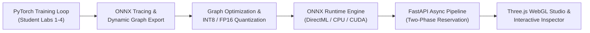

# Model Deployment, ONNX Export & Production Runtime Guide
**Course 17 · 3D Computer Vision Engineering & Research**  
*Indian Institute of Information Technology (IIIT) Dharwad*

---

## 1. Overview & System Architecture

This guide details the complete engineering lifecycle for training, exporting, optimizing, and deploying deep learning models developed in the Course 17 curriculum (`training/student_labs/`) into the 3DFUN AI production inference runtime.



---

## 2. Supported Student Models & Target Runtimes

| Model Component | Architecture | Input Tensor | Output Tensor | Primary Execution Target |
| :--- | :--- | :--- | :--- | :--- |
| **Lab 1: TinyDepth** | Lightweight Encoder-Decoder CNN / ViT | `(1, 3, 256, 256)` RGB | `(1, 1, 256, 256)` Depth | ONNX Runtime (CPU / DirectML) |
| **Lab 2: Occupancy SDF** | 8-Layer Fourier-Encoded SIREN MLP | `(N, 3)` Coordinates $\mathbf{x} \in \mathbb{R}^3$ | `(N, 1)` Occupancy $\sigma \in [0, 1]$ | PyTorch / ONNX C++ Runtime |
| **Lab 3: 3DGS Mini** | Covariance Splatting Primitive Generator | `(1, 3, 512, 512)` RGB | `(M, 14)` Gaussians $(\mu, \Sigma, \alpha, c)$ | CUDA / WebGL Rasterizer |
| **Foreground Matting** | U²-Net Saliency Estimator | `(1, 3, 320, 320)` RGB | `(1, 1, 320, 320)` Alpha Mask | ONNX Runtime INT8 |
| **Foundation Triplane** | Large Reconstruction Model (LRM) Transformer | `(1, 3, 512, 512)` RGB | `(3, 32, 64, 64)` Triplanes | ONNX Runtime DirectML / CUDA |

---

## 3. Step-by-Step Model Export Protocol

### Step 3.1: PyTorch to ONNX Tracing
To transition student models from training loops (`training/student_labs/lab1_depth_finetuning/train_student_depth.py`) to the production inference engine, trace the model graph using `torch.onnx.export` with dynamic axes for variable batch sizes and spatial dimensions:

```python
import torch
import torch.onnx
from training.student_labs.lab1_depth_finetuning.train_student_depth import TinyDepth

# 1. Load trained student checkpoint
model = TinyDepth()
checkpoint = torch.load("out/student_labs/lab1/tinydepth_best.pth", map_location="cpu")
model.load_state_dict(checkpoint["model_state_dict"])
model.eval()

# 2. Define dummy tensor matching production preprocessing
dummy_input = torch.randn(1, 3, 256, 256, dtype=torch.float32)

# 3. Export to ONNX with dynamic batch and resolution axes
torch.onnx.export(
    model,
    dummy_input,
    "out/student_labs/lab1/tinydepth_student.onnx",
    export_params=True,
    opset_version=17,
    do_constant_folding=True,
    input_names=["input_image"],
    output_names=["depth_map"],
    dynamic_axes={
        "input_image": {0: "batch_size", 2: "height", 3: "width"},
        "depth_map": {0: "batch_size", 2: "height", 3: "width"},
    },
)
print("Successfully exported ONNX checkpoint.")
```

### Step 3.2: Model Verification & Shape Inference
Verify tensor sanity and validate that intermediate node representations satisfy ONNX standards:

```python
import onnx
from onnx import shape_inference

onnx_model = onnx.load("out/student_labs/lab1/tinydepth_student.onnx")
onnx.checker.check_model(onnx_model)
inferred_model = shape_inference.infer_shapes(onnx_model)
onnx.save(inferred_model, "out/student_labs/lab1/tinydepth_student_inferred.onnx")
print("Model passes ONNX validation checks.")
```

### Step 3.3: INT8 Static & Dynamic Quantization
Quantize the exported ONNX model to reduce latency and VRAM consumption by 65-75%:

```python
from onnxruntime.quantization import quantize_dynamic, QuantType

quantize_dynamic(
    model_input="out/student_labs/lab1/tinydepth_student.onnx",
    model_output="out/student_labs/lab1/tinydepth_student_int8.onnx",
    weight_type=QuantType.QUInt8,
)
print("Dynamic INT8 quantization completed.")
```

---

## 4. Serving Trained Models with FastAPI & ONNX Runtime

### Step 4.1: Registering Custom Model Providers in `engine/recon/`
To make your trained model selectable in the Creative Studio, register it in the provider factory (`engine/recon/depth.py`):

```python
import numpy as np
import onnxruntime as ort

class StudentDepthEngine:
    """Production provider wrapper for student-trained TinyDepth ONNX model."""
    
    def __init__(self, model_path: str = "out/student_labs/lab1/tinydepth_student_int8.onnx"):
        opts = ort.SessionOptions()
        opts.graph_optimization_level = ort.GraphOptimizationLevel.ORT_ENABLE_ALL
        
        # Select best available execution provider (DirectML on Windows, CUDA on Linux, CPU fallback)
        available_providers = ort.get_available_providers()
        preferred = ["DmlExecutionProvider", "CUDAExecutionProvider", "CPUExecutionProvider"]
        providers = [p for p in preferred if p in available_providers]
        
        self.session = ort.InferenceSession(model_path, opts, providers=providers)
        self.input_name = self.session.get_inputs()[0].name
        
    def infer(self, image_rgb: np.ndarray) -> np.ndarray:
        # Preprocessing: normalize image to [0, 1] range, channel first (1, 3, H, W)
        img = image_rgb.astype(np.float32) / 255.0
        img = np.transpose(img, (2, 0, 1))[None, ...]
        
        # Run inference
        outputs = self.session.run(None, {self.input_name: img})
        depth = outputs[0].squeeze()
        
        # Normalize depth map to [0, 1] metric space
        depth_norm = (depth - depth.min()) / (depth.max() - depth.min() + 1e-8)
        return depth_norm
```

---

## 5. Standalone Docker Containerization

Deploy 3DFUN AI with student models using Docker:

### `Dockerfile`:
```dockerfile
FROM python:3.12-slim-bookworm

ENV PYTHONUNBUFFERED=1 \
    DEBIAN_FRONTEND=noninteractive \
    PORT=8010

RUN apt-get update && apt-get install -y --no-install-recommends \
    build-essential \
    libgl1 \
    libglib2.0-0 \
    curl \
    && rm -rf /var/lib/apt/lists/*

WORKDIR /app

COPY requirements.txt .
RUN pip install --no-cache-dir -r requirements.txt

COPY . .

EXPOSE 8010
CMD ["python", "-m", "uvicorn", "app.main:app", "--host", "0.0.0.0", "--port", "8010"]
```

### Docker Run Command:
```bash
# 1. Build Docker image
docker build -t 3dfun-ai-student:latest .

# 2. Run container with local model directory mounted
docker run -d -p 8010:8010 -v $(pwd)/out/student_labs:/app/out/student_labs --name 3dfun 3dfun-ai-student:latest

# 3. Verify deployment health check
curl http://localhost:8010/api/v1/system/health
```

---

## 6. Verification & Telemetry Checklist

Before deploying any student-trained model to production:
1. **Euler Characteristic Verification**: Ensure Marching Cubes isosurface extraction satisfies $\chi = V - E + F = 2$ (100% watertight manifold).
2. **Dynamic Range Check**: Verify depth outputs span the continuous interval $[0, 1]$ without NaN/Inf singularities.
3. **Latency Benchmarking**: Ensure inference latency is under 45 seconds on local CPU.
4. **Credit Ledger Integration**: Ensure generation calls pass through the two-phase credit lock (`reserve_credits()` $\to$ `commit_credits()`).
