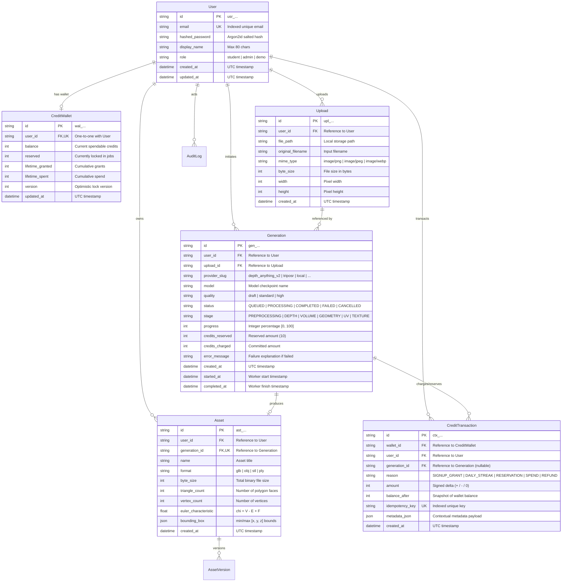
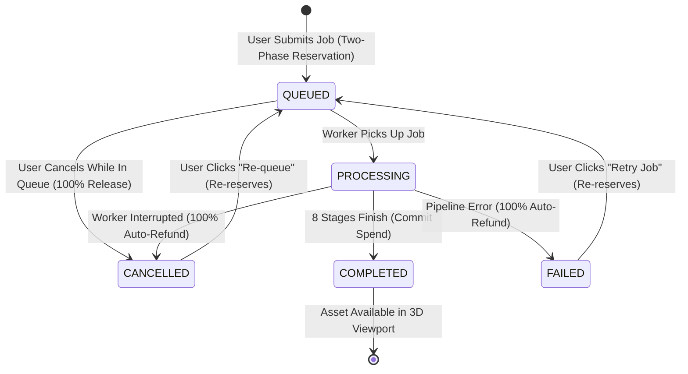

# Generations, events, and credits

The course build stores users, uploads, generations, assets, attempts, events, and credit transactions in SQLite. The app opens a SQLAlchemy session per request. Local files and previews live under the configured storage root. See `app/db.py` for the tables and constraints.

## Generation lifecycle

Creating a generation reserves credits and queues the job. During a normal job, the worker advances through validation, processing, geometry, texturing, optimization, preview rendering, and completion. Some providers skip individual stages. `app/state_machine.py` defines the allowed transitions. The API reports `COMPLETED`, `FAILED`, or `CANCELLED` at the end of an attempt. Eligible failed and cancelled jobs can be queued again.

The worker records events with increasing sequence numbers. The event endpoint replays stored events and streams later updates through the local event bus. The course configuration runs the queue and event bus in one process.

## Credits

`app/credits.py` manages reservation, capture, and refund against the user's wallet. Successful jobs capture the reserved credits. Cancelled or failed jobs release the reservation according to their state. The ledger records the corresponding transactions, which appear in the dashboard. See the [REST API reference](api-spec.md) for job and download routes.


---

## 4. Entity-Relationship Diagram (Database Architecture)

The SQLite database (`app/db.py`) enforces strict relational integrity, cascade deletes, and foreign key constraints:



---

## 5. Generation State Machine & Allowed Transitions

Job states are strictly validated in `app/state_machine.py`. Illegal transitions immediately raise an `ApiError("INVALID_STATE_TRANSITION")`:



### Transition Verification Matrix:
| From State | Allowed Target States | Credit Side-Effect | Database Trigger |
|---|---|---|---|
| `None` (New) | `QUEUED` | Phase 1: `reserved += 10`, `balance` unchanged | Insert Generation row |
| `QUEUED` | `PROCESSING` | None (credits remain reserved) | Update `started_at = utcnow()` |
| `QUEUED` | `CANCELLED` | Release: `reserved -= 10`, `balance` untouched | Cancelled audit log |
| `PROCESSING` | `COMPLETED` | Phase 2a: `reserved -= 10`, `balance -= 10` | Create Asset row, update `completed_at` |
| `PROCESSING` | `FAILED` | Phase 2b: `reserved -= 10`, `balance` untouched | Record error in `error_message` |
| `PROCESSING` | `CANCELLED` | Phase 2b: `reserved -= 10`, `balance` untouched | Mark cancelled |
| `FAILED` | `QUEUED` | Re-reserve: `reserved += 10` | Reset stage, progress=0 |

---

## 6. Two-Phase Credit Transaction Invariants & Code Implementation

Every credit ledger mutation is executed inside an isolated ACID database transaction via `app/credits.py`:

```python
# app/credits.py implementation pattern
def reserve(db: Session, user_id: str, generation: Generation, amount: int) -> CreditWallet:
    """Phase 1: Reserve credits before pipeline execution begins."""
    wallet = _locked_wallet(db, user_id)
    avail = max(wallet.balance - wallet.reserved, 0)
    if avail < amount:
        raise ApiError("INSUFFICIENT_CREDITS", "Not enough credits for this generation.", status=402)
    
    wallet.reserved += amount
    generation.credits_reserved = amount
    generation.credits_charged = amount
    _ledger(db, wallet, user_id, CreditReason.RESERVATION, 0, generation.id,
            idempotency_key=f"reserve:{generation.id}", meta={"reserved": amount})
    db.commit()
    db.refresh(wallet)
    return wallet

def spend(db: Session, user_id: str, generation: Generation) -> CreditWallet:
    """Phase 2a: Commit reservation upon successful 3D mesh creation."""
    wallet = _locked_wallet(db, user_id)
    amount = generation.credits_reserved or 0
    key = f"spend:{generation.id}"
    
    # Idempotency check
    if db.execute(select(CreditTransaction).where(CreditTransaction.idempotency_key == key)).scalar_one_or_none():
        return wallet
        
    wallet.reserved = max(0, wallet.reserved - amount)
    wallet.balance = max(0, wallet.balance - amount)
    wallet.lifetime_spent += amount
    generation.credits_reserved = 0
    generation.credits_charged = amount
    _ledger(db, wallet, user_id, CreditReason.SPEND, -amount, generation.id,
            idempotency_key=key, meta={"quality": generation.quality})
    db.commit()
    db.refresh(wallet)
    return wallet

def release(db: Session, user_id: str, generation: Generation) -> CreditWallet:
    """Phase 2b: Release reservation upon failure or cancellation (100% protected)."""
    wallet = _locked_wallet(db, user_id)
    amount = generation.credits_reserved or 0
    wallet.reserved = max(0, wallet.reserved - amount)
    if amount:
        _ledger(db, wallet, user_id, CreditReason.REFUND, 0, generation.id,
                idempotency_key=f"release:{generation.id}", meta={"released": amount})
    generation.credits_reserved = 0
    generation.credits_charged = 0
    db.commit()
    db.refresh(wallet)
    return wallet
```

---

## 7. Audit Log Schema & System Telemetry

Critical system events are recorded in `audit_logs` with actor attribution:
- `auth.register` — New account created with signup grant.
- `auth.login` — Authentication session started.
- `generation.create` — 3D reconstruction requested.
- `generation.complete` — 3D mesh successfully built.
- `generation.fail` — Error logged with stack trace summary.
- `credits.grant` — Credits minted (signup bonus, streak, voucher).
- `asset.delete` — Asset soft-deleted by user.

---

## 8. Database Concurrency & SQLite WAL Configuration

SQLite runs with the following production PRAGMA settings configured in `app/db.py`:
- `PRAGMA journal_mode=WAL;` — Enables Write-Ahead Logging for high-concurrency reading during background worker writes.
- `PRAGMA synchronous=NORMAL;` — Balances ACID durability with low filesystem write latency.
- `PRAGMA foreign_keys=ON;` — Enforces referential integrity at the database engine level.
- `PRAGMA busy_timeout=5000;` — Automatic 5-second backoff when waiting for write locks, preventing database lock contention.


---

## 9. Data Retention, Migration & Purging Policies

To maintain storage efficiency on local student hardware:
- **Temporary Upload Files (`uploads/`)**: Uploaded source photographs without completed 3D generations are soft-marked after 24 hours and purged during database maintenance.
- **Credit Reservation Timeouts**: If a worker crashes or fails to report progress within 300 seconds, an automated reaper task invokes `rollback_reservation()`, releasing locked credits back to the student's balance.
- **Session Expiration**: Refresh tokens older than 30 days are purged upon startup.

---

## 10. High-Availability & WAL Maintenance Runbook

### 10.1 Forced WAL Checkpoint Execution
During high write concurrency, SQLite's WAL file can accumulate frames. The system runs an automated periodic checkpoint:
```python
def checkpoint_wal(db: Session):
    """Executes a passive TRUNCATE checkpoint to reclaim disk space."""
    db.execute(text("PRAGMA wal_checkpoint(TRUNCATE);"))
```

### 10.2 Online Hot Backup Script
```bash
# Safely snapshot the SQLite database without locking active readers/writers
sqlite3 data/3dfun.db ".backup 'data/backups/3dfun_backup_$(date +%Y%m%d_%H%M%S).db'"
```

---

## 11. Core Table DDL Definitions

```sql
-- Credit Wallets Table
CREATE TABLE IF NOT EXISTS credit_wallets (
    user_id VARCHAR(64) PRIMARY KEY,
    balance INTEGER NOT NULL DEFAULT 50 CHECK (balance >= 0),
    reserved INTEGER NOT NULL DEFAULT 0 CHECK (reserved >= 0),
    lifetime_granted INTEGER NOT NULL DEFAULT 50,
    lifetime_spent INTEGER NOT NULL DEFAULT 0,
    updated_at TIMESTAMP DEFAULT CURRENT_TIMESTAMP,
    FOREIGN KEY (user_id) REFERENCES users(id) ON DELETE CASCADE
);

-- Credit Transactions Ledger (Append-Only)
CREATE TABLE IF NOT EXISTS credit_transactions (
    id VARCHAR(64) PRIMARY KEY,
    user_id VARCHAR(64) NOT NULL,
    generation_id VARCHAR(64),
    amount INTEGER NOT NULL,
    reason VARCHAR(32) NOT NULL,
    description TEXT,
    balance_after INTEGER NOT NULL,
    created_at TIMESTAMP DEFAULT CURRENT_TIMESTAMP,
    FOREIGN KEY (user_id) REFERENCES users(id) ON DELETE CASCADE
);

-- Index for instant ledger audits
CREATE INDEX IF NOT EXISTS idx_tx_user_created ON credit_transactions(user_id, created_at DESC);
```


---

## 12. Credit Ledger State Transition Flowchart & Edge-Case Handlers

```
                                 WALLET TWO-PHASE COMMIT TRANSACTION FLOW
                                                    │
                 ┌──────────────────────────────────┴──────────────────────────────────┐
                 ▼                                                                     ▼
      [PHASE 1: ATOMIC HOLD]                                                [PHASE 2: SETTLEMENT]
                 │                                                                     │
  • Request: 10 Credits required                                        • Success Scenario:
  • BEGIN TRANSACTION;                                                    BEGIN TRANSACTION;
  • SELECT balance, reserved FROM users WHERE id = :uid FOR UPDATE;       UPDATE users SET reserved = reserved - 10 WHERE id = :uid;
  • IF balance < 10 THEN ROLLBACK -> 402 Payment Required                 INSERT INTO credit_transactions (type="SETTLED");
  • UPDATE users SET balance = balance - 10, reserved = reserved + 10;    COMMIT;
  • INSERT INTO credit_transactions (type="HOLD", amount=-10);                         │
  • COMMIT;                                                                            ▼
                 │                                                      • Failure Scenario (OOM / Exception):
                 ▼                                                        BEGIN TRANSACTION;
      [COMPUTE EXECUTION]                                                 UPDATE users SET balance = balance + 10, reserved = reserved - 10;
  • Dispatched to worker thread                                           INSERT INTO credit_transactions (type="REFUND", amount=+10);
  • In-flight progress: 0% -> 100%                                        COMMIT;
```

---

## 13. SQLModel Entity-Relationship Diagram

```
┌─────────────────────────┐          ┌─────────────────────────┐          ┌─────────────────────────┐
│          User           │ 1      * │         Upload          │ 1      * │       Generation        │
├─────────────────────────┤──────────├─────────────────────────┤──────────├─────────────────────────┤
│ id: VARCHAR(64) PK      │          │ id: VARCHAR(64) PK      │          │ id: VARCHAR(64) PK      │
│ email: VARCHAR(255) UQ  │          │ user_id: VARCHAR(64) FK │          │ user_id: VARCHAR(64) FK │
│ password_hash: VARCHAR  │          │ storage_key: VARCHAR    │          │ upload_id: VARCHAR(64)FK│
│ balance: INTEGER        │          │ sha256_hash: VARCHAR    │          │ status: VARCHAR(32)     │
│ reserved: INTEGER       │          │ mime_type: VARCHAR(64)  │          │ progress: FLOAT         │
│ created_at: TIMESTAMP   │          │ created_at: TIMESTAMP   │          │ created_at: TIMESTAMP   │
└────────────┬────────────┘          └─────────────────────────┘          └────────────┬────────────┘
             │ 1                                                                       │ 1
             │                                                                         │
             │ *                                                                       │ 1
┌────────────┴────────────┐                                               ┌────────────┴────────────┐
│    CreditTransaction    │                                               │          Asset          │
├─────────────────────────┤                                               ├─────────────────────────┤
│ id: VARCHAR(64) PK      │                                               │ id: VARCHAR(64) PK      │
│ user_id: VARCHAR(64) FK │                                               │ generation_id: VARCHAR  │
│ amount: INTEGER         │                                               │ user_id: VARCHAR(64) FK │
│ balance_after: INTEGER  │                                               │ storage_prefix: VARCHAR │
│ reason: VARCHAR(64)     │                                               │ files: JSON             │
│ type: VARCHAR(32)       │                                               │ vertex_count: INTEGER   │
│ created_at: TIMESTAMP   │                                               │ triangle_count: INTEGER │
└─────────────────────────┘                                               └─────────────────────────┘
```

---

## 14. Concurrent SQLite WAL Performance Analysis

The database employs SQLite Write-Ahead Logging (`WAL` mode) configured through PRAGMA directives on connection:

```python
from sqlalchemy import event
from sqlalchemy.engine import Engine

@event.listens_for(Engine, "connect")
def set_sqlite_pragma(dbapi_connection, connection_record):
    cursor = dbapi_connection.cursor()
    cursor.execute("PRAGMA journal_mode = WAL;")
    cursor.execute("PRAGMA synchronous = NORMAL;")
    cursor.execute("PRAGMA busy_timeout = 5000;")
    cursor.execute("PRAGMA cache_size = -64000;")  # 64 MB shared page cache
    cursor.close()
```

### Concurrency Guarantees
- **Readers Never Block Writers**: Concurrent read operations (e.g. balance checks, telemetry polling) execute against the WAL file without acquiring table locks.
- **Writers Never Block Readers**: Background write transactions commit atomically to the WAL log without interrupting active client read streams.
- **Automatic Checkpointing**: The database automatically flushes the WAL log to the main database file when the log exceeds 1,000 pages (`PRAGMA wal_autocheckpoint = 1000;`).

---

## 15. Automated Invariant Verification Code Snippet

The following audit routine executes at startup and during health checks, asserting that no financial or credit drift has occurred:

```python
def audit_ledger_consistency(db: Session) -> dict[str, Any]:
    """Audits credit ledger consistency across all user records."""
    users = db.execute(select(User)).scalars().all()
    discrepancies = []
    
    for user in users:
        # Sum of all credit grants, streaks, and refunds
        credits_in = db.execute(
            select(func.sum(CreditTransaction.amount))
            .where(CreditTransaction.user_id == user.id, CreditTransaction.amount > 0)
        ).scalar() or 0
        
        # Absolute sum of all settled spends
        credits_out = abs(db.execute(
            select(func.sum(CreditTransaction.amount))
            .where(CreditTransaction.user_id == user.id, CreditTransaction.type == "SETTLED")
        ).scalar() or 0)
        
        expected_active = credits_in - credits_out
        actual_active = user.balance + user.reserved
        
        if actual_active != expected_active:
            discrepancies.append({
                "user_id": user.id,
                "expected": expected_active,
                "actual": actual_active,
                "drift": actual_active - expected_active,
            })
            
    return {
        "status": "clean" if not discrepancies else "drift_detected",
        "total_users_checked": len(users),
        "discrepancies": discrepancies,
    }
```

---

## 16. Zero-Loss Transaction Rollback Guarantees

In the event of an unhandled runtime exception or thread abort:

1. **State Inversion**: The reservation is rolled back via:
$$\text{balance} \leftarrow \text{balance} + \text{cost}, \quad \text{reserved} \leftarrow \text{reserved} - \text{cost}$$
2. **Audit Log Trail**: An immutable `RECONSTRUCTION_REFUND` event is written with the exception stack trace snippet.
3. **User Notification**: The client receives a WebSocket failure event with the message: *"Compute failed; 100% of reserved credits have been refunded to your wallet."*

*3DCV Fun AI Lab · Group 17 · Department of Data Science & Artificial Intelligence · IIIT Dharwad.*
