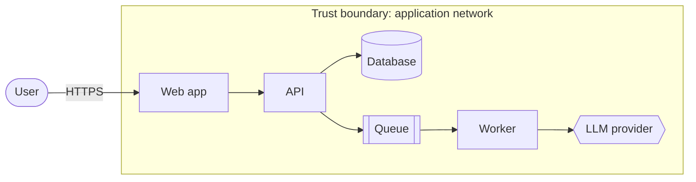
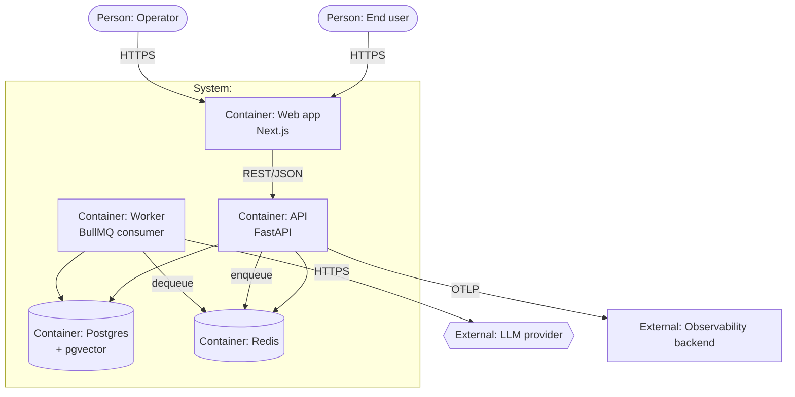
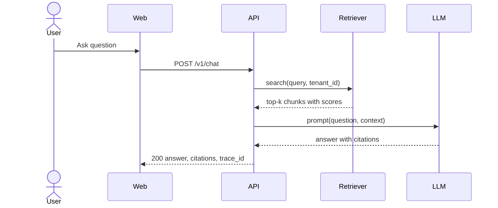
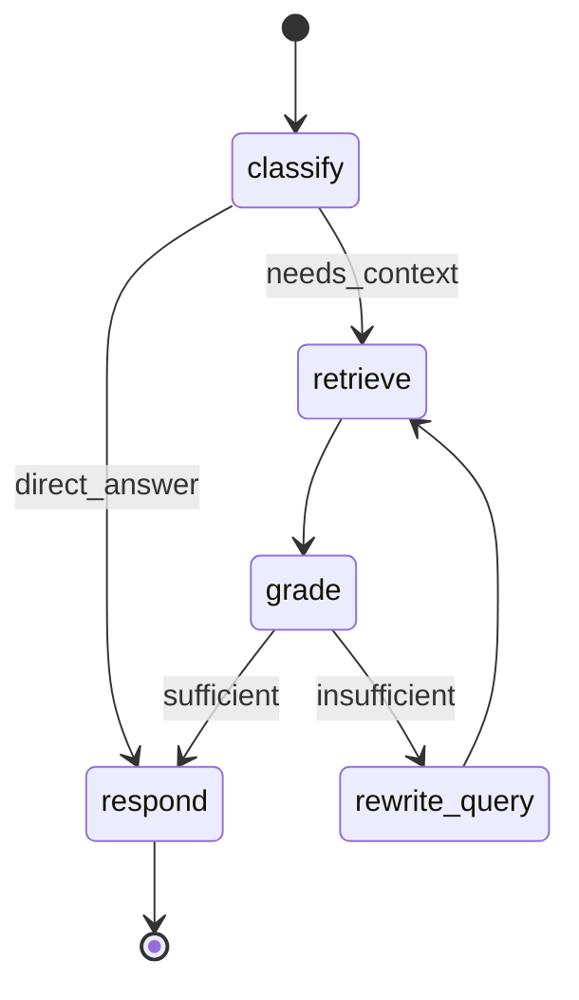

# PRODUCTION DOCUMENTATION MASTER PROMPT

Version 1.0 — 2026-11-08
Purpose: make a coding agent (Claude Code or Claude with repo access) produce production-ready technical documentation for a full-stack and/or AI project, modeled on practices from well-known open-source projects, **without deleting or rewriting any existing documentation**.

---

## 0. HOW TO USE THIS PROMPT

1. Open your repository root in Claude Code.
2. Fill the variable block in §0.1 (leave a value blank to auto-detect it from the repo).
3. Paste everything from `## 1. ROLE AND MISSION` to the end of the file.
4. With `AUTONOMY: checkpoint` (default) the agent stops after Phase 1 (audit) and Phase 2 (information architecture) and waits for your "go". With `AUTONOMY: autonomous` it runs to the end and reports.

### 0.1 Variables

```
PROJECT_NAME:
PROJECT_ONE_LINER:
PROJECT_TYPE:          # full-stack | ai-rag | ai-agents | ml-training | library | monorepo   (blank = detect)
PRIMARY_AUDIENCES:     # blank = new developer, operator/on-call, API consumer, security reviewer, contributor
DOCS_SITE_TOOL:        # auto | mkdocs | docusaurus | starlight | none   (blank = auto, see §10.1)
LICENSE_TYPE:          # blank = keep existing; if none exists, ask
COMPLIANCE_CONTEXT:    # none | gdpr | dpdp | soc2 | hipaa | eu-ai-act  (comma separated; blank = none)
DEPLOY_TARGETS:        # blank = detect (docker-compose | kubernetes | vercel | aws | gcp | azure | bare-metal)
AUTONOMY:              # checkpoint | autonomous   (default checkpoint)
LANGUAGE:              # default en
```

---

## 1. ROLE AND MISSION

You are a principal technical writer and staff engineer in one person. You are documenting a real codebase for real readers. Your job is to leave the repository with documentation that a new engineer, an on-call operator, an API consumer, a security reviewer, and an AI auditor can each use **without asking anyone a question**.

Success is not "many pages". Success is the seven acceptance tests in §4 passing.

Work from the code outward: read the code, run the code, then write. Every statement in the docs must be traceable to something you read or ran.

---

## 2. NON-NEGOTIABLE RULES

### R1. Never delete or rewrite existing documentation

This is the highest-priority rule.

- Existing documentation files stay at their current path with their current content. No deletes, no renames, no `git mv`, no "cleanup", no reformatting.
- Existing text is immutable. To correct an outdated statement, **add** a callout directly above it and keep the original text below:

  ```markdown
  > **Superseded (verified 2026-11-08):** The port is now `8080`. See [Configuration reference](../reference/configuration.md).
  ```

- Root community files that already exist (README, CONTRIBUTING, and so on) are extended **additively**: insert missing sections in logical places and never remove or reword existing lines. If a full rewrite is clearly warranted, write it to `docs/_meta/proposed-edits/<FILE>.proposed.md` and ask the user to approve the swap.
- Pure typo fixes in existing files are also proposals. List them in `docs/_meta/proposed-edits/typos.md` (file, line, before, after) for a batch approval.
- New documentation lives in new files. If a new filename collides with an existing one, give the new file a descriptive suffix and link both ways.
- This rule is enforced mechanically by `scripts/docs/check-no-deletions.sh` (§10.3) and a CI job. Run it before every commit.
- If you are ever unsure whether an action destroys information, do not do it. Add instead.

### R2. Ground every claim in evidence

- Each non-trivial factual statement (a command, a default value, a port, a limit, a behavior) must come from code you read, a command you ran, or a source you fetched.
- End each page with an **Evidence** footer listing file paths and symbol names (not line numbers, they rot):

  ```markdown
  **Evidence:** `src/api/routes/documents.py` (`upload_document`), `src/workers/ingest.py` (`IngestWorker.run`), `docker-compose.yml` (service `worker`).
  ```

### R3. Never fabricate

- Do not invent metrics, benchmarks, SLO targets, customer names, team members, dates, version numbers, URLs, or decisions.
- When information is not in the repo and cannot be verified, write it to `docs/_meta/open-questions.md` as a precise question with the page that needs the answer, and put a visible marker in the page: `> [!NOTE] Needs owner confirmation: <question>`.
- Proposed values (for example an SLO target or a response SLA) are labelled **Proposed** until an owner confirms them.
- At the end of the run the number of unresolved markers must be small, listed, and each must be a question only a human can answer.

### R4. One purpose per page (Diátaxis)

Every page in `docs/` belongs to exactly one quadrant: tutorial, how-to, reference, or explanation (§7). Records and runbooks (§7.5) follow their own templates. Never mix quadrants on a page. Link out instead.

### R5. Examples are executable

- Every command block must be copy-paste runnable on a clean machine, show expected output where it is short, and have been run by you (log it in `docs/_meta/verification-log.md`).
- If you cannot run something (no credentials, no GPU), mark it `unverified` in the log and in the page.

### R6. Write timelessly

Avoid "currently", "now", "soon", "recently", "in the future", "new". State the version a statement applies to using front matter `applies_to`.

### R7. No secrets, no personal data

Use `example.com`, `example.org`, placeholder keys such as `sk-...-REDACTED`, and `.env.example` values. Never paste real tokens, emails, or user data from the repo, logs, or traces.

### R8. Single source of truth

Generate reference pages from code or schemas wherever possible (OpenAPI, DB schema, config definitions). Do not hand-copy tables that can drift. When hand-written, point to the source in the Evidence footer and add a coverage check (§10.5).

### R9. Docs live with the code and are versioned with it

Everything is Markdown in the repository. Every page renders correctly on GitHub without a docs site. The docs site is a bonus, not a dependency.

### R10. Every page has an owner and a review date

Front matter schema in §9.2 is mandatory for new pages.

### R11. Small, reviewable commits

One commit per logical unit. Conventional Commit messages: `docs(scope): summary`. Never mix code changes with docs changes unless the code change is strictly needed (for example adding an OpenAPI `summary` field or an `.env.example` entry) and is called out separately.

### R12. Study open source for structure, not for prose

When you study reference projects (Appendix C), record **structure and techniques** in `docs/_meta/benchmark-notes.md`. Do not copy their prose. Paraphrase, and cite the source. Respect licenses.

### R13. Verify tooling facts before relying on them

Tool versions, flags, GitHub Action versions, and regulations change. Before you use a tool, standard, or regulation, confirm its current state with web search or the tool's own `--help`, and record the result in `docs/_meta/verification-log.md`.

### R14. Ask only blocking questions

Make reasonable decisions, state them, and move on. Ask the user only when a wrong guess is expensive or irreversible (license choice, security contact, public disclosure policy, deleting anything).

---

## 3. EVIDENCE BASE (WHAT THE RESEARCH SHOWED)

This prompt is built from the following findings. Re-verify anything that matters (R13).

| Practice | Finding | Where this prompt uses it |
|---|---|---|
| **Diátaxis** | Four documentation types (tutorials, how-to guides, reference, explanation) driven by two axes: action vs cognition and acquisition vs application. Adopters report it exposes gaps and conflations in existing docs. Canonical adopted it as the foundation of its documentation. | §7 information architecture and page rules |
| **arc42 + C4** | arc42 gives a 12-section architecture template; C4 gives diagram levels (Context, Container, Component, Code). Combined with docs-as-code (AsciiDoc/Markdown, Structurizr DSL, PlantUML, adr-tools) in published examples. Smaller projects should not use full arc42. | §8.3 architecture docs |
| **MADR ADRs** | Markdown Architectural Decision Records, current 4.0.0, stored in `docs/decisions` with `NNNN-title-with-dashes.md` names, optional sections keep short decisions short. | §8.4 decision records, template A |
| **Docs-as-code quality gates** | Prose linting (Vale), Markdown linting, internal link checks on every PR, external link checks on a schedule, OpenAPI linting (Spectral), preview builds. GitLab runs markdownlint, Vale and link checks in CI for its docs. | §10 automation |
| **Style guide** | Google developer documentation style guide is used by many open-source projects (Kubernetes, AMP, Dart contributors); second person, present tense, active voice, serial comma; "timeless documentation". | §9 style |
| **Community files** | README, CONTRIBUTING, CODE_OF_CONDUCT, SECURITY (plus LICENSE, CODEOWNERS, issue/PR templates) are the recognised minimum for open-source projects. | §8.1 |
| **Keep a Changelog + SemVer** | Changelog grouped by version with Added, Changed, Deprecated, Removed, Fixed, Security, and an Unreleased section. | §8.1, template L |
| **Runbooks and postmortems** | Runbooks need detection, severity, immediate steps, troubleshooting, escalation, post-incident tasks, and must be tested in drills. Postmortems are blameless with summary, timeline, root cause, impact, action items with owners and dates. | §8.6, templates B and C |
| **SLO / production readiness** | SLIs measure behavior, SLOs set targets (never 100%), error budgets drive release decisions (99.9% over 30 days ≈ 43.2 minutes of downtime), production readiness reviews check health probes, alerts, capacity, runbooks. | §8.7, template H |
| **Model cards and datasheets** | Model cards (intended use, evaluation, limitations) and datasheets for datasets (provenance, composition, collection, maintenance). For LLM systems the card must be a living artifact tied to evaluation runs and extended to a system card that covers the whole stack (retriever, router, tool selector, generator). EU AI Act Annex IV requires technical documentation for high-risk systems. | §8.9 AI documentation |
| **OWASP Top 10 for LLM Applications (2025)** | Ten risks; new entries System Prompt Leakage and Vector and Embedding Weaknesses; Unbounded Consumption covers token floods and runaway cost. | §8.8 security docs, template F |
| **RAG evaluation and LLMOps** | Evaluate retrieval (context precision/recall) and generation (faithfulness, answer relevancy); trace each stage as separate spans; version prompts, models, datasets like code; feed production failures back into the test set. | §8.9, template I |
| **Langfuse as a documentation exemplar** | Architecture page with containers and datastores (web, worker, Postgres, ClickHouse, Redis, blob storage), deployment matrix (local Docker Compose, production Kubernetes/cloud/Terraform), upgrade guides between major versions, troubleshooting/FAQ, every page available as raw Markdown, and an `llms.txt` index. | §8.1 (`llms.txt`), §8.5, Appendix C |

---

## 4. WHAT "PRODUCTION-READY DOCUMENTATION" MEANS (ACCEPTANCE TESTS)

The work is finished only when all seven tests pass. Run them in Phase 5 and record the result of each in `docs/_meta/acceptance-report.md`.

| # | Persona | Test | Pass condition |
|---|---|---|---|
| T1 | New developer | From a clean machine, follow `tutorials/getting-started.md` only. | App runs locally in 15 minutes or less, with no undocumented step. |
| T2 | Contributor | Make a small change (new endpoint or UI field) using only the how-to guides. | Change, test, lint and docs update are all achievable from the docs. |
| T3 | API consumer | Integrate with the API using only the generated API reference and the auth guide. | Every operation has description, parameters, request and response examples, errors, auth. |
| T4 | Operator at 3 a.m. | Given an alert, find the runbook from the alert text and resolve it. | Every alert links to a runbook with detection, triage, mitigation, escalation. |
| T5 | Security reviewer | Assess trust boundaries, data flows, secrets, and AI-specific risks. | Threat model, OWASP LLM mapping, data classification and disclosure policy exist and match the code. |
| T6 | AI auditor | Explain what each model does, on which data, how it is evaluated, and its known limits. | System card, model cards, datasheets, evaluation reports, and the prompt registry exist and link to each other. |
| T7 | Maintainer | Cut a release and upgrade a deployment using only the docs. | Release process, upgrade guide, rollback steps, and changelog exist and agree with CI. |

---

## 5. EXECUTION PLAN

```
┌──────────┐   ┌──────────┐   ┌────────────┐   ┌──────────┐   ┌───────────┐   ┌──────────┐   ┌──────────┐   ┌──────────┐
│ PHASE 0  │──►│ PHASE 1  │──►│  GATE A    │──►│ PHASE 2  │──►│  GATE B   │──►│ PHASE 3  │──►│ PHASE 4  │──►│ PHASE 5  │
│ Recon +  │   │ Audit +  │   │ user says  │   │ Info     │   │ user says │   │ Write    │   │ Automate │   │ Verify + │
│ baseline │   │ coverage │   │ "go"       │   │ arch.    │   │ "go"      │   │ (areas)  │   │ (CI)     │   │ report   │
└──────────┘   └──────────┘   └────────────┘   └──────────┘   └───────────┘   └──────────┘   └──────────┘   └──────────┘
     │                                                                              │
     └── baseline manifest + preservation guard (R1) ──────────────────────────────┘ runs before EVERY commit
```

Gates A and B apply only when `AUTONOMY: checkpoint`. In `autonomous` mode, continue but still write the audit and plan files.

Parallelism: in Phase 3, split writing across sub-agents with disjoint write scopes (§11). Run a fresh-context reviewer in Phase 5.

Create a task list at the start and update it as you go. The last task is always "verify".

---

## 6. PHASES 0 AND 1: RECONNAISSANCE, BASELINE, AUDIT

### Phase 0. Reconnaissance and non-destructive baseline

**0.1 Safety setup**

```bash
git status --porcelain                  # must be empty; if not, STOP and ask the user (do not stash silently)
git switch -c docs/production-overhaul
mkdir -p docs/_meta scripts/docs
git rev-parse HEAD > docs/_meta/baseline-sha.txt
```

**0.2 Inventory every existing documentation-like file**

```bash
find . -type f \( -iname '*.md' -o -iname '*.mdx' -o -iname '*.rst' -o -iname '*.adoc' -o -iname '*.txt' \
  -o -iname '*.ipynb' -o -iname '*.puml' -o -iname '*.drawio' -o -iname 'openapi*.y*ml' -o -iname 'openapi*.json' \) \
  -not -path '*/node_modules/*' -not -path '*/.git/*' -not -path '*/.venv/*' -not -path '*/venv/*' \
  -not -path '*/dist/*' -not -path '*/build/*' -not -path '*/.next/*' -not -path '*/__pycache__/*' \
  -not -path '*/site-packages/*' -not -name 'requirements*.txt' -not -name 'robots.txt' \
  | sed 's|^\./||' | sort > docs/_meta/inventory.txt

# manifest: "<sha256>  <path>" (two spaces). On macOS replace sha256sum with: shasum -a 256
while IFS= read -r f; do sha256sum "$f"; done < docs/_meta/inventory.txt > docs/_meta/baseline-manifest.txt
```

Commit these three files first: `docs(meta): record documentation baseline`.

**0.3 Install the preservation guard now**

Create `scripts/docs/check-no-deletions.sh` (full source in §10.3), make it executable, run it, commit it.

**0.4 Detect the system profile**

Read, at minimum, whichever of these exist: `package.json`, `pnpm-workspace.yaml`, `turbo.json`, `nx.json`, `pyproject.toml`, `requirements*.txt`, `Dockerfile*`, `docker-compose*.yml`, `helm/`, `k8s/`, `terraform/`, `.github/workflows/`, `Makefile`, `.env.example`, `prisma/schema.prisma`, `alembic/`, `migrations/`, `openapi*`, `next.config.*`, `vite.config.*`, `tsconfig*.json`.

Search the code for the signals below and record each hit with its file path:

| Signal | Search for |
|---|---|
| HTTP routes | `@app.get(`, `@router.`, `APIRouter(`, `app.get(`, `router.get(`, `@Controller(` |
| Env vars | `os.getenv`, `os.environ`, `process.env`, `import.meta.env`, `BaseSettings` |
| Queues and jobs | `new Queue(`, `new Worker(`, `BullMQ`, `@celery.task`, `rq`, `arq` |
| Database | `prisma`, `sqlalchemy`, `alembic`, `typeorm`, `drizzle`, `CREATE TABLE`, `pgvector` |
| Vector stores | `chromadb`, `qdrant`, `faiss`, `pinecone`, `weaviate`, `pgvector` |
| LLM calls | `ChatOpenAI`, `anthropic`, `google.generativeai`, `ollama`, `vllm`, `transformers`, `litellm` |
| Fine-tuning | `peft`, `LoraConfig`, `bitsandbytes`, `trl`, `SFTTrainer` |
| Orchestration | `StateGraph(`, `add_node(`, `add_edge(`, `langchain`, `llama_index`, `crewai` |
| Prompts | `PromptTemplate`, `ChatPromptTemplate`, `prompts/`, `system_prompt` |
| Tools | `@tool`, `Tool(`, `tools=[`, JSON schema function definitions |
| Auth | `jwt`, `oauth`, `passport`, `next-auth`, `clerk`, `supabase.auth`, `Depends(get_current_user` |
| Observability | `opentelemetry`, `prometheus`, `sentry`, `langfuse`, `structlog`, `pino`, `winston` |
| Frontend | `app/`, `pages/`, `components/`, `storybook`, `tailwind`, `zustand`, `redux`, `react-query` |

**0.5 Run the project and learn the real commands**

Try install, build, test, lint, and start. Record every command and its outcome (passed, failed, unverifiable and why) in `docs/_meta/verification-log.md` as a table:

```markdown
| Date | Command | Working dir | Result | Notes |
|---|---|---|---|---|
| 2026-11-08 | `docker compose up -d --wait` | repo root | pass | postgres, redis healthy in 14 s |
```

**0.6 Write `docs/_meta/system-profile.md`**

Sections: languages and versions; frameworks; services and processes; datastores; queues; external APIs and LLM providers; vector store; auth; deployment; CI/CD; test tooling; observability; what could not be determined. Each line carries an evidence path.

### Phase 1. Audit and coverage analysis

**1.1 Document audit** → `docs/_meta/audit-report.md`

For every file in `docs/_meta/inventory.txt`:

| Path | Quadrant | Audience | Accuracy vs code | Issues | Disposition |
|---|---|---|---|---|---|
| `docs/setup.md` | how-to | developer | partially stale (port, env var names) | mixes reference | **Keep in place**, add superseded callouts, link from new index |

Accuracy values: `accurate`, `partially stale`, `stale`, `unverifiable`. Disposition values are only: `keep in place`, `keep in place + add superseded callout`, `link from new index`. **There is no "delete" and no "move" disposition.**

**1.2 Coverage matrix** → `docs/_meta/coverage-matrix.md`

For each surface below, list every item found in code and whether it is documented (and where). The matrix drives Phase 3.

| Surface | How to extract |
|---|---|
| HTTP operations | OpenAPI export (§10.6) or route grep |
| Environment variables | `scripts/docs/check-config-coverage.py` (§10.5) |
| Database tables, columns, indexes | ORM models, migrations, `\dt+` / `tbls` / SchemaSpy |
| Queues, jobs, schedules | grep from 0.4 |
| CLI commands and scripts | `Makefile`, `package.json` scripts, `pyproject.toml` entry points |
| Metrics, log fields, spans | grep for metric registration and logger setup |
| Prompts, tools, agents, graphs | grep from 0.4 |
| Models (LLM, embedding, rerank, fine-tuned adapters) | config files, model registries |
| Corpora and datasets | ingestion code, `data/` directories |
| Roles and permissions | auth and policy code |
| Feature flags | flag provider code or config |
| Third-party services | env vars, SDK imports, `docker-compose.yml` |

**1.3 Open questions** → start `docs/_meta/open-questions.md`.

**GATE A (checkpoint mode):** stop and present: the system profile, the audit summary (counts by disposition), the coverage matrix gaps, and the open questions. Wait for the user's "go".

---

## 7. PHASE 2: INFORMATION ARCHITECTURE

### 7.1 Principles

- User-facing and developer-facing docs follow Diátaxis: tutorials (learning, action), how-to guides (goals, action), reference (information, cognition), explanation (understanding, cognition).
- Living engineering artifacts that are not Diátaxis types (decisions, postmortems, threat models, model cards, runbooks, evaluations, readiness reviews) live under `records/` and `runbooks/` with their own templates.
- Runbooks get a separate top-level folder because alerts link to them and their paths must be short and stable.
- Existing documents stay where they are. Add `docs/index.md` with a section **Existing documents** that links every file from the baseline inventory, grouped by the quadrant assigned in the audit.

### 7.2 Target tree

Create only what the system needs (skip AI folders for non-AI projects, skip frontend for API-only projects). Do not create empty placeholder files; create a file only when you can fill it with verified content.

```
README.md                          (extend additively if present)
CONTRIBUTING.md  CODE_OF_CONDUCT.md  SECURITY.md  SUPPORT.md  GOVERNANCE.md*  CHANGELOG.md  LICENSE
AGENTS.md                          conventions and commands for AI coding agents
llms.txt                           generated index of docs for LLM tools
.github/
  CODEOWNERS  PULL_REQUEST_TEMPLATE.md  ISSUE_TEMPLATE/{bug.yml,feature.yml,config.yml}
  workflows/docs.yml
docs/
  index.md                         front door: persona-based navigation + "Existing documents"
  tutorials/        getting-started.md  first-rag-query.md*  build-your-first-feature.md
  how-to/
    develop/        run-tests.md  debug-backend.md  add-api-endpoint.md  add-db-migration.md
                    add-frontend-page.md  add-background-job.md  add-env-var.md  write-docs.md
    operate/        deploy.md  rollback.md  rotate-secrets.md  scale-workers.md  backup-restore.md
                    upgrade.md  zero-downtime-migration.md  setup-observability.md
    ai/*            add-document-source.md  change-embedding-model.md  add-agent-tool.md
                    change-prompt.md  run-evaluation.md  compare-variants.md  finetune-lora.md
                    switch-llm-provider.md  add-guardrail.md  debug-bad-answer.md
    security/       report-vulnerability.md  rotate-signing-keys.md
  reference/
    api/            openapi.md (rendered)  authentication.md  errors.md  rate-limits.md  webhooks.md*
    configuration.md  cli.md  database.md  events-and-queues.md  permissions.md
    observability-catalog.md  feature-flags.md  limits.md  compatibility.md  glossary.md
    frontend.md*    (routes, env, components index)
    ai/*            rag-pipeline.md  prompts.md  tools.md  models.md  evaluation-metrics.md
  explanation/
    architecture/   01-introduction-and-goals.md … 12-glossary.md  (or one file for small systems)
                    diagrams/
    concepts/       domain-model.md  multi-tenancy.md  authn-authz.md  async-processing.md  consistency-and-caching.md
    security/       trust-boundaries.md
    ai/*            overview.md  rag-design.md  agents.md  safety-and-guardrails.md  limitations.md  cost-and-latency.md
  records/
    decisions/      0000-use-markdown-architectural-decision-records.md  NNNN-*.md
    rfcs/*
    postmortems/
    threat-models/  system.md  ai.md*
    model-cards/*   system-card.md  <model>.md
    datasheets/*    <corpus>.md
    evaluations/*   evaluation-plan.md  YYYY-MM-DD-<name>.md
    readiness/      prr-<release>.md
  runbooks/         index.md  <alert-name>.md
  release/          release-process.md  versioning-policy.md  upgrade-guides/
  _meta/            (audit, manifest, coverage, style guide, open questions, verification log, benchmark notes, proposed-edits)
  templates/        (every template in the appendix, as files)
openapi/            openapi.json  (generated, committed)
scripts/docs/       (§10)
```

`*` = only if applicable.

### 7.3 Sizing rules

- README: 200 lines or fewer. Tutorial: 15 minutes or fewer. How-to: one task, ideally 5 to 12 steps. Explanation: 800 to 2,000 words. Reference: as long as complete, but generated where possible. Any page over about 600 lines should be split.
- Every page links to its neighbours: tutorial → next how-to; how-to → relevant reference; reference → explanation; explanation → ADRs.

### 7.4 Front door `docs/index.md`

Persona table ("I want to…" → link), the five-line system summary, the architecture diagram, the **Existing documents** section, and "How these docs are organised" (one paragraph explaining Diátaxis in plain words).

### 7.5 Naming and file rules

- Lowercase kebab-case filenames, no spaces. Numeric prefixes only for ordered series (arc42 sections, ADR numbers).
- ADRs: `docs/records/decisions/NNNN-title-with-dashes.md`.
- Runbooks: named after the alert, for example `queue-backlog-high.md`.
- Every directory with more than 5 pages has an `index.md`.

Save the plan to `docs/_meta/information-architecture.md`, including the list of files you will create, who the audience is, and which code surface each covers.

**GATE B (checkpoint mode):** present the plan and wait for "go".

---

## 8. PHASE 3: WRITE THE DOCUMENTATION

Work in the order below. For each page, use the templates in the appendix. Every page: front matter (§9.2), one quadrant, Evidence footer (R2), links to neighbours.

### 8.1 Root and community files

| File | Must contain |
|---|---|
| `README.md` | One-sentence value proposition; status badges (build, version, license); a diagram or screenshot; who it is for and not for; a **tested** 5-minute quickstart; feature list; architecture at a glance (Mermaid) with link; docs map by persona; tech stack table; project maturity and support policy; links to CONTRIBUTING, SECURITY, LICENSE. 200 lines or fewer. |
| `CONTRIBUTING.md` | Dev setup (link to tutorial); branching; Conventional Commits; test and lint commands; PR checklist including "docs updated"; review expectations; how to propose an ADR or RFC; how to write docs (link to style guide); release process (link). DCO or CLA only if the project has one. |
| `CODE_OF_CONDUCT.md` | Adopt the current Contributor Covenant text verbatim (fetch the official text; do not paraphrase). Enforcement contact is an open question for the user. |
| `SECURITY.md` | Supported versions table; private reporting channel (GitHub private advisories or a security email, ask the user); what to include in a report; response targets (mark **Proposed** until confirmed); coordinated disclosure policy; scope in and out; safe harbor wording; AI-specific scope (prompt injection, data leakage, model misbehavior reports). |
| `SUPPORT.md` | Where to ask questions, how to file a bug, what is out of scope, response expectations. |
| `GOVERNANCE.md` | Only for multi-maintainer open-source projects: roles, decision process, how maintainers are added. |
| `CHANGELOG.md` | Keep a Changelog format with `Unreleased`; backfill from git tags and merged PRs without inventing entries; link versions to tag comparisons. |
| `.github/CODEOWNERS` | Docs paths owned by named teams or maintainers (ask the user for handles if absent). |
| `.github/PULL_REQUEST_TEMPLATE.md` | Includes the documentation checklist from template M. |
| `.github/ISSUE_TEMPLATE/*` | Bug, feature, and a config that links to docs and security policy. |
| `AGENTS.md` | For AI coding agents: project map, exact commands (install, test, lint, run), conventions, file ownership, "never do" list (for example never edit generated files), links to docs. Keep under 200 lines. |
| `llms.txt` | Generated index of all docs pages with one-line descriptions (script in §10.7). Keep each docs page available as raw Markdown. |

### 8.2 Tutorials

| Page | Specification |
|---|---|
| `tutorials/getting-started.md` | Prerequisites with exact versions; clone; configure env from `.env.example`; start dependencies; migrate and seed; run backend and frontend; verify with `curl --fail` and the browser; expected output; "what you built"; next steps. Commands in `bash testable` blocks run in CI (§10.4). 15 minutes or fewer. Troubleshooting table at the end linking to how-to pages. |
| `tutorials/first-rag-query.md` (AI) | Ingest a sample document, ask a question, read the answer with citations, open the trace, see the retrieval scores. |
| `tutorials/build-your-first-feature.md` | One end-to-end change through database, API, UI, tests, and docs. |

Tutorial rules: the reader learns by doing; no choices, no digressions, no reference tables; the steps must work every time on every supported environment.

### 8.3 Explanation: architecture

Pick the depth by system size. Under about 10 source files, a single `explanation/architecture/overview.md` is enough. Otherwise use arc42's 12 sections:

1. Introduction and goals (requirements, quality goals, stakeholders)
2. Constraints (technical, organisational, regulatory)
3. Context and scope (business context, technical context; C4 level 1)
4. Solution strategy (key technology and design decisions, linked to ADRs)
5. Building block view (C4 level 2 containers, level 3 components)
6. Runtime view (sequence diagrams for the 3 to 6 most important scenarios, including an AI request path if relevant)
7. Deployment view (infrastructure, environments, mapping of containers to nodes)
8. Cross-cutting concepts (auth, errors, logging, caching, i18n, multi-tenancy, observability, AI safety)
9. Architecture decisions (index of ADRs)
10. Quality requirements (quality tree and scenarios; link SLOs)
11. Risks and technical debt
12. Glossary

Diagram rules: Mermaid in Markdown (renders on GitHub); one diagram answers one question; every box and arrow labelled; a legend if non-obvious; keep an ASCII fallback in code blocks when a diagram must work in a terminal. Provide at minimum: system context, container diagram, the primary request sequence, the deployment diagram, and (AI) the RAG pipeline and agent graph. Examples are in Appendix B.

### 8.4 Records: Architecture Decision Records

- Directory `docs/records/decisions/`, MADR 4.0.0 format (template A), numbered `NNNN-title-with-dashes.md`.
- First record `0000-use-markdown-architectural-decision-records.md`.
- **Retroactive ADRs.** Reconstruct the major historical decisions from `git log`, dependency manifests and configs. For each, write the decision, the evidence, and the drivers you can verify. Where the original rationale is not recorded, say so: `Rationale not recorded in the repository; inferred drivers: …; needs owner confirmation`. Status is `accepted (retroactive)`. Never invent reasons.
- Minimum set for a full-stack AI system: language and framework; API style; database; vector store; queue and worker model; authentication; LLM provider and model; embedding model; chunking and retrieval strategy; orchestration framework; deployment target; observability stack; frontend rendering mode; monorepo and tooling.

### 8.5 Reference

Generate where possible; hand-write only what cannot be generated.

| Page | Required content |
|---|---|
| `reference/api/*` | OpenAPI 3.1 spec committed at `openapi/openapi.json` (generated by script, §10.6) and rendered with Redoc or Swagger UI in the site. Every operation: summary, description, parameters with constraints, request and response examples, error responses, auth requirement, rate limit, idempotency, pagination, stability label (stable, beta, deprecated). Separate hand-written pages: authentication, errors, rate limits, webhooks (AsyncAPI if events are public). |
| `reference/configuration.md` | One table per component: Name, Type, Default, Required, Secret (yes/no), Where read (file), Effect, Example, Valid values, Since version. Every environment variable found by the coverage script must appear. |
| `reference/database.md` | Mermaid `erDiagram`; per table: purpose, columns (type, null, default), keys, indexes, retention, owner service; migration policy; for vector columns: dimension, distance metric, index type and parameters. |
| `reference/events-and-queues.md` | Per queue or job: name, producer, consumer, payload schema, retries and backoff, concurrency, timeout, idempotency key, dead-letter handling, metrics to watch. |
| `reference/api/errors.md` | Error code catalog: code, HTTP status, meaning, typical cause, remedy, retryable. |
| `reference/permissions.md` | Role by action matrix; tenant isolation rules; how permissions are checked (file reference). |
| `reference/observability-catalog.md` | Metrics (name, type, unit, labels, SLI mapping), structured log fields and correlation IDs, trace spans and attributes (for LLM spans: model, prompt version, token counts, latency, cost), alert list with runbook link for each alert. |
| `reference/cli.md` | Every script and CLI command with synopsis, options, examples, exit codes. |
| `reference/limits.md`, `compatibility.md`, `feature-flags.md`, `glossary.md` | Limits and quotas; supported versions of runtimes, databases, browsers; flags with default, owner, removal plan; domain and technical terms (also feeds Vale vocabulary, §10.2). |
| `reference/ai/*` | See §8.9. |

Reference rules: neutral, complete, structured like the thing it describes, no instructions and no explanation (link out).

### 8.6 Runbooks and postmortems

Directory `docs/runbooks/`, one runbook per alert, named after the alert, using template B. Every alert in the observability catalog links to its runbook and vice versa. At minimum, write runbooks for the failure modes that exist in this system:

- API error rate high; API latency high
- Database connection saturation; slow queries; migration failure
- Queue backlog or dead-letter growth; worker crash loop
- Cache (Redis) unavailable
- Vector store degraded or index missing
- LLM provider outage, timeouts, or rate limiting (HTTP 429)
- LLM cost spike or runaway token consumption
- Retrieval quality regression (empty or irrelevant retrievals)
- Suspected prompt injection or data leakage
- Disk full; certificate expiry
- Failed deploy and rollback; secret leak; data restore

Runbook rules: written so that a person who has never seen the system can follow it at 3 a.m.; commands are copy-paste with placeholders clearly marked; each step has a verification check; test by walking through it (record the date in front matter `last_drill`); update after every incident.

`docs/records/postmortems/` holds the blameless postmortem template (template C) and an index. Do not write fake postmortems.

### 8.7 Operations documentation

| Page | Required content |
|---|---|
| `how-to/operate/deploy.md` | Each deploy target detected (Compose, Kubernetes/Helm, cloud, Vercel): prerequisites, exact commands, health verification, rollback pointer. |
| `reference/environments.md` | Dev, staging, production: URLs (placeholders), differences, config sources, access policy, data policy. |
| `explanation/architecture/07-deployment-view.md` | Diagram and narrative of infrastructure. |
| `reference/slo.md` | SLI definitions, **Proposed** SLO targets (availability, latency, error rate, and for AI: groundedness, cost per request), the error budget calculation, the error budget policy table, the alerts that burn against it. Never propose 100%. |
| `records/readiness/prr-<release>.md` | Production readiness review using template H. |
| `how-to/operate/backup-restore.md` | What is backed up, schedule, retention, restore steps, restore test date. |
| `how-to/operate/upgrade.md` + `release/upgrade-guides/` | Version-to-version steps, breaking changes, data migrations, rollback. |
| `release/release-process.md` | Versioning (SemVer), branching, changelog update, tagging, artifact publishing, post-release verification. |
| `explanation/ai/cost-and-latency.md` | Token and cost model per request path, budgets, alert thresholds (all values sourced from code or marked Proposed). |

### 8.8 Security documentation

| Page | Required content |
|---|---|
| `records/threat-models/system.md` | STRIDE threat model (template F): scope, data-flow diagram, trust boundaries, assets, threats per element (spoofing, tampering, repudiation, information disclosure, denial of service, elevation of privilege), existing controls (file references), residual risk, owner, review date. |
| `records/threat-models/ai.md` | OWASP Top 10 for LLM Applications (2025) mapping (template F, AI section): for each of LLM01 to LLM10 state applicability, where it occurs in this system, controls, tests, residual risk. Verify the current list at genai.owasp.org before writing (R13). |
| `explanation/security/trust-boundaries.md` | Narrative of boundaries, authentication, authorization, secrets, tenant isolation. |
| `reference/data-classification.md` | Data classes (public, internal, confidential, restricted), where each is stored, retention, encryption, who can access. Includes prompts, responses, traces, embeddings. |
| `explanation/security/privacy.md` | Personal data inventory, purposes, retention and deletion, redaction in logs and traces, subprocessors (LLM providers), and the applicable regimes from `COMPLIANCE_CONTEXT`. State that this is engineering documentation and not legal advice; verify current regulatory text (R13). |
| `explanation/security/supply-chain.md` | Dependency management, lockfiles, SBOM generation, vulnerability scanning, container image provenance, model and dataset provenance. |

### 8.9 AI and LLM documentation

Include this section when the repository uses LLMs, embeddings, agents, or trains models. Model documentation must be a **living artifact** tied to evaluation runs, not a static launch note.

**System card** — `records/model-cards/system-card.md` (template D). Documents the whole stack, not only the base model: retriever, reranker, router, tool selector, generator, guardrails. It aggregates the component cards and links to the latest evaluation report.

**Model cards** — one per model used, in `records/model-cards/<model>.md`: provider and exact model identifier or checkpoint hash, version pinning policy, intended use, out-of-scope use, inputs and outputs, evaluation results (linked), limitations, known failure modes, licensing, cost and latency profile, owners, review date. For fine-tuned models (LoRA, QLoRA, PEFT) also: base model, adapter configuration (rank, alpha, target modules, dropout), quantization settings, training data version, hyperparameters, seed, hardware, library versions, training command, how to reproduce, how to merge and serve, adapter registry location.

**Datasheets** — one per corpus or training dataset in `records/datasheets/<corpus>.md` (template E): provenance, license, collection method, composition, preprocessing, PII handling, known biases, refresh cadence, retention and deletion procedure, access control, maintainers.

**RAG pipeline reference** — `reference/ai/rag-pipeline.md` with an ASCII or Mermaid flow and a parameter table for each stage:

```
 ┌────────┐  ┌───────┐  ┌────────┐  ┌───────┐  ┌────────┐  ┌────────┐  ┌────────┐  ┌──────────┐  ┌─────────┐
 │ Source │─►│ Parse │─►│ Clean  │─►│ Chunk │─►│ Embed  │─►│ Index  │  │ Query  │─►│ Retrieve │─►│ Rerank  │─┐
 └────────┘  └───────┘  └────────┘  └───────┘  └────────┘  └────────┘  └────────┘  └──────────┘  └─────────┘ │
                                                                                                             ▼
        ┌──────────┐  ┌───────────┐  ┌────────────┐  ┌──────────────┐  ┌───────────────────┐   ┌────────────────┐
        │ Response │◄─│ Citations │◄─│ Generate   │◄─│ Context      │◄─│ Guardrails (in)   │◄──│ Context budget │
        └──────────┘  └───────────┘  └────────────┘  │ assembly     │  └───────────────────┘   └────────────────┘
                                                     └──────────────┘
```

For each stage record: component and library, parameters with values (chunk size, overlap, embedding model and dimension, normalization, index type and parameters, top-k, filters, hybrid weights, reranker, token budget, temperature, max tokens), error handling, caching, and metrics emitted. Values come from code and config, never from memory.

**Prompt registry** — `reference/ai/prompts.md` (template J): id, purpose, version, owner, file location, variables, compatible models, linked evaluation IDs, change log. Policy: prompts are versioned, reviewed and evaluated like code; a prompt change without an evaluation run is not releasable.

**Tools and agents** — `reference/ai/tools.md` (template K) lists every tool with schema, side effects, permissions, timeouts, idempotency, human-approval requirement. `explanation/ai/agents.md` documents orchestration: a Mermaid `stateDiagram-v2` of the graph (nodes, edges, conditions), the state schema, checkpointing, interrupts, retries, and termination rules. Connect each tool's permissions to the Excessive Agency risk in the AI threat model.

**Evaluation** — `records/evaluations/evaluation-plan.md` and dated reports (template I): golden dataset (size, sourcing, versioning, how production failures are added), retrieval metrics (context precision, context recall), generation metrics (faithfulness, answer relevancy), task-specific metrics, human-review rubric, red-team results, latency and cost, the thresholds that gate releases in CI, and the command to reproduce. Reports record dataset version, model and prompt versions, and date. Link each report from the system card.

**Safety and limitations** — `explanation/ai/safety-and-guardrails.md` (input and output guardrails, injection defenses, system-prompt handling, tenant isolation of embeddings, rate and token limits, human-in-the-loop points, refusal policy) and `explanation/ai/limitations.md` (known failure modes, unsupported uses, how users should verify answers).

**LLM observability** — in `reference/observability-catalog.md`: one trace per request with separate spans for retrieval, augmentation and generation; attributes for model, prompt version, token counts, cost, latency, retrieval ids and scores; sampling policy; PII redaction; dashboards for cost, latency, error rate, groundedness trend; how production failures flow back into the evaluation dataset.

**Data lifecycle** — retention and deletion of prompts, responses, traces and embeddings; user consent where applicable.

**Regulatory mapping** — only when `COMPLIANCE_CONTEXT` includes `eu-ai-act` or similar: map existing artifacts to the required technical documentation items (for the EU AI Act, Annex IV and the general-purpose AI model documentation form). Verify the current text first (R13), keep the mapping factual, and say it is not legal advice.

### 8.10 Frontend and backend documentation

**Backend** (`explanation/concepts/*`, `reference/*`, plus per-package README): layering and module map; API conventions (versioning, pagination, error format, idempotency keys, rate limiting); authentication and authorization flow; validation; background jobs; caching and invalidation; transactions and consistency; migration policy; logging, tracing, and correlation; configuration handling; testing strategy and how to run each layer; performance and load-test results (only real ones).

**Frontend** (`reference/frontend.md`, `explanation/concepts/frontend-architecture.md`): routing and rendering modes (SSR, SSG, CSR, ISR) with the reason per route; data fetching and state management; auth flow in the browser; environment variables exposed to the client; component library or Storybook; design tokens; accessibility target (for example WCAG 2.2 AA) and how it is tested; performance budgets; browser support; i18n; error handling; analytics and privacy.

**Monorepos**: each package or app gets a short `README.md` (purpose, public interface, run, test, owner) and appears in the root docs index.

---

## 9. STYLE AND CONTENT STANDARDS

Save this section as `docs/_meta/style-guide.md` (adapted, not weakened). The authority order is: project style, then this guide, then the Google developer documentation style guide, then Merriam-Webster for spelling.

### 9.1 Writing rules

- Second person ("you"), present tense, active voice, serial comma, American English unless the repo is clearly otherwise.
- Sentence case headings. One H1 per page. Headings are descriptive and unique within the page.
- Lead with the point. Put the reason or condition before the instruction ("To rotate the key, run…").
- Short sentences. Define a term once in the glossary and use it consistently. No synonyms for the same concept.
- Numbered lists for sequences, bullets for sets, tables for comparisons or attributes.
- Timeless wording (R6). No marketing language. No unexplained acronyms on first use.
- Code: fenced with a language tag; prefer long flags (`--header`, not `-H`); one command per line when possible; show expected output; use placeholders in angle brackets and say what to replace; never include prompts (`$`) in copy-paste blocks.
- Admonitions: GitHub alerts (`> [!NOTE]`, `> [!WARNING]`, `> [!IMPORTANT]`) so they render on GitHub.
- Links: relative paths, descriptive link text ("see the [configuration reference](../reference/configuration.md)", never "click here").
- Images and diagrams: alt text required; diagrams as text (Mermaid or ASCII) so they diff and review well.
- Accessibility: meaningful headings, alt text, no information by colour alone, table headers.

### 9.2 Front matter (mandatory for new pages)

```yaml
---
title: Short, specific title
description: One sentence saying what the reader gets from this page
quadrant: tutorial | how-to | reference | explanation | record | runbook | policy
audience: [developer, operator, api-consumer, security, auditor, contributor]
owner: "@handle-or-team"
status: draft | reviewed | stable | deprecated
last_reviewed: 2026-11-08
review_every_days: 90
applies_to: ">=1.0.0"
source_of_truth: [path/or/glob/in/code]
---
```

### 9.3 Quadrant quality checks

| Quadrant | Test |
|---|---|
| Tutorial | Does a beginner finish with a working result, with no decisions to make and no explanation detours? |
| How-to | Does it solve one real task for someone who already knows the basics, with conditionals only where reality demands them? |
| Reference | Is it complete, accurate, consistently structured, and free of instruction and opinion? |
| Explanation | Does it give context, reasons, alternatives and trade-offs, and link to ADRs? |

If a page fails its test, split it.

---

## 10. PHASE 4: AUTOMATION AND QUALITY GATES

Documentation that is not checked by machines drifts. Treat docs as code: lint prose, lint Markdown, check links on every pull request, lint the API contract, test the quickstart, check freshness, check coverage. Run internal link checks on pull requests and external link checks on a schedule so reviews stay fast.

### 10.1 Docs site (optional, never a dependency)

| Stack | Default | Alternative |
|---|---|---|
| Python-first repo | MkDocs (with a Material-style theme) | Sphinx with MyST |
| Node or Next.js repo | Docusaurus or Starlight | Nextra, Fumadocs |
| No site wanted | `none`: GitHub renders Markdown | — |

Before committing to a generator, check its current maintenance status and versions with web search (R13) and record the result. Whatever you choose, the site must build with warnings treated as errors (`mkdocs build --strict`, Docusaurus `onBrokenLinks: 'throw'`), and must be built by `make docs-build`.

### 10.2 Configuration files to create

`.vale.ini`:

```ini
StylesPath = .vale/styles
MinAlertLevel = warning
Vocab = Project
Packages = Google

[*.md]
BasedOnStyles = Vale, Google
# Tune noisy rules after the first run; record every change in docs/_meta/style-guide.md
Google.Parens = NO
```

`.vale/styles/config/vocabularies/Project/accept.txt`: one term per line. Seed it from the glossary and the dependency list (framework, library and product names such as the ones found in Phase 0), for example `FastAPI`, `LangGraph`, `pgvector`, `BullMQ`, `OpenTelemetry`, `RAG`, `LoRA`, `QLoRA`, `PEFT`.

`.markdownlint-cli2.jsonc`:

```jsonc
{
  "config": {
    "default": true,
    "MD013": false,
    "MD024": { "siblings_only": true },
    "MD033": { "allowed_elements": ["details", "summary", "br", "img", "kbd", "sub", "sup", "picture", "source"] },
    "MD041": false,
    "MD046": { "style": "fenced" }
  },
  "ignores": ["node_modules/**", "docs/_meta/baseline-manifest.txt", "docs/templates/**"]
}
```

`lychee.toml`:

```toml
max_redirects = 5
max_retries = 3
retry_wait_time = 2
timeout = 20
accept = ["200..=299", "429"]
exclude = ["^https?://localhost", "^https?://127\\.0\\.0\\.1", "^https?://example\\.(com|org)", "^mailto:"]
exclude_path = ["node_modules", ".git"]
```

`.spectral.yaml`:

```yaml
extends: ["spectral:oas"]
rules:
  operation-description: error
  operation-operationId: error
  operation-tags: error
  info-contact: warn
  info-description: error
  oas3-api-servers: warn
  operation-success-response: error
  contract-has-examples:
    description: Every JSON response schema or media type should have an example.
    severity: warn
    given: "$.paths[*][*].responses[*].content['application/json']"
    then:
      field: example
      function: truthy
```

Legacy-baseline files are exempt from the lint steps (R1: you may not edit them to fix findings). The scripts below lint only files that are **not** in the baseline manifest.

### 10.3 Preservation guard (R1)

`scripts/docs/check-no-deletions.sh`:

```bash
#!/usr/bin/env bash
# Fails if any documentation file that existed at the baseline commit is missing or,
# in strict mode, has had lines removed.
set -euo pipefail

MANIFEST="docs/_meta/baseline-manifest.txt"
BASE_SHA_FILE="docs/_meta/baseline-sha.txt"
STRICT="${DOCS_STRICT_LINES:-0}"

[[ -f "$MANIFEST" && -f "$BASE_SHA_FILE" ]] || { echo "baseline files missing"; exit 2; }
BASE_SHA="$(cat "$BASE_SHA_FILE")"
status=0

while IFS= read -r line; do
  [[ -z "$line" ]] && continue
  path="$(printf '%s' "$line" | cut -c67-)"     # sha256 (64) + two spaces
  if [[ ! -e "$path" ]]; then
    echo "DELETED OR MOVED: $path"
    status=1
    continue
  fi
  if [[ "$STRICT" == "1" ]]; then
    removed="$(git diff --numstat "$BASE_SHA" -- "$path" | awk '{print $2}')"
    if [[ -n "$removed" && "$removed" != "0" && "$removed" != "-" ]]; then
      echo "LINES REMOVED ($removed): $path"
      status=1
    fi
  fi
done < "$MANIFEST"

if [[ $status -eq 0 ]]; then echo "OK: all baseline documentation preserved"; fi
exit $status
```

Use `DOCS_STRICT_LINES=1` throughout the overhaul so even removed lines are caught. CI must check out with `fetch-depth: 0`.

`scripts/docs/list-new-docs.sh` (files the lint steps are allowed to judge):

```bash
#!/usr/bin/env bash
set -euo pipefail
MANIFEST="docs/_meta/baseline-manifest.txt"
cut -c67- "$MANIFEST" | sort > /tmp/baseline-paths.txt
{
  find docs -type f -name '*.md' -not -path 'docs/_meta/*' -not -path 'docs/templates/*'
  find . -maxdepth 1 -type f -name '*.md' | sed 's|^\./||'
} | sort -u | comm -23 - /tmp/baseline-paths.txt
```

### 10.4 Quickstart test

Mark every command block that must work from a clean checkout with the info string `bash testable`. `scripts/docs/test-quickstart.sh`:

```bash
#!/usr/bin/env bash
# Runs every ```bash testable block of the given Markdown files, in order.
set -euo pipefail
FILES=("${@:-docs/tutorials/getting-started.md}")
TMP="$(mktemp)"
for f in "${FILES[@]}"; do
  awk '/^```bash testable/{flag=1; next} /^```/{flag=0} flag' "$f" >> "$TMP"
done
echo "Running $(wc -l < "$TMP") lines of testable commands"
bash -euo pipefail "$TMP"
```

Rules for testable blocks: start services with `docker compose up -d --wait`; verify with `curl --fail`; no interactive prompts; blocks that start long-running foreground processes are not `testable` (use plain `bash`) or are backgrounded with a cleanup `trap`.

### 10.5 Freshness and coverage checks

`scripts/docs/doc-freshness.py`:

```python
#!/usr/bin/env python3
"""Fail when new docs lack front matter, use an unknown quadrant, or are overdue for review."""
import datetime
import pathlib
import re
import sys

REQUIRED = {"title", "description", "quadrant", "owner", "status", "last_reviewed"}
QUADRANTS = {"tutorial", "how-to", "reference", "explanation", "record", "runbook", "policy"}
SKIP_DIRS = {"_meta", "templates"}
FRONT = re.compile(r"\A---\n(.*?)\n---\n", re.S)


def parse(block: str) -> dict:
    data = {}
    for line in block.splitlines():
        m = re.match(r"^([A-Za-z_][\w-]*):\s*(.*)$", line)
        if m:
            data[m.group(1)] = m.group(2).strip().strip("\"'")
    return data


def baseline_paths() -> set:
    manifest = pathlib.Path("docs/_meta/baseline-manifest.txt")
    if not manifest.exists():
        return set()
    return {line[66:] for line in manifest.read_text().splitlines() if len(line) > 66}


def main(root: str = "docs") -> int:
    today = datetime.date.today()
    legacy = baseline_paths()
    problems = []
    for path in sorted(pathlib.Path(root).rglob("*.md")):
        if any(part in SKIP_DIRS for part in path.parts):
            continue
        text = path.read_text(encoding="utf-8", errors="replace")
        match = FRONT.match(text)
        if not match:
            if str(path) not in legacy:
                problems.append(f"{path}: missing front matter")
            continue
        fm = parse(match.group(1))
        missing = REQUIRED - fm.keys()
        if missing:
            problems.append(f"{path}: missing keys {sorted(missing)}")
            continue
        if fm["quadrant"] not in QUADRANTS:
            problems.append(f"{path}: unknown quadrant '{fm['quadrant']}'")
        try:
            reviewed = datetime.date.fromisoformat(fm["last_reviewed"])
            every = int(fm.get("review_every_days", "90"))
        except ValueError:
            problems.append(f"{path}: invalid last_reviewed or review_every_days")
            continue
        if (today - reviewed).days > every:
            problems.append(f"{path}: overdue (last_reviewed {reviewed}, every {every} days)")
    for p in problems:
        print(p)
    print(f"{len(problems)} problem(s)")
    return 1 if problems else 0


if __name__ == "__main__":
    sys.exit(main(*sys.argv[1:]))
```

`scripts/docs/check-config-coverage.py` (every environment variable used in code must appear in the configuration reference):

```python
#!/usr/bin/env python3
"""Fail when an environment variable found in code or .env.example is not documented."""
import pathlib
import re
import sys

EXCLUDE = {"node_modules", ".git", ".venv", "venv", "dist", "build", ".next", "__pycache__",
           "site-packages", "coverage", ".turbo"}
CODE_EXT = {".py", ".js", ".jsx", ".ts", ".tsx", ".mjs", ".cjs"}
CODE_PATTERNS = [
    r"os\.getenv\(\s*['\"]([A-Z][A-Z0-9_]+)['\"]",
    r"os\.environ\.get\(\s*['\"]([A-Z][A-Z0-9_]+)['\"]",
    r"os\.environ\[\s*['\"]([A-Z][A-Z0-9_]+)['\"]\s*\]",
    r"process\.env\.([A-Z][A-Z0-9_]+)",
    r"process\.env\[\s*['\"]([A-Z][A-Z0-9_]+)['\"]\s*\]",
    r"import\.meta\.env\.([A-Z][A-Z0-9_]+)",
]
ENV_FILE = re.compile(r"^\s*(?:export\s+)?([A-Z][A-Z0-9_]+)\s*=", re.M)
DOC = pathlib.Path("docs/reference/configuration.md")
IGNORE = pathlib.Path("docs/_meta/config-ignore.txt")   # one name per line, with a reason in a comment


def scan(root: pathlib.Path) -> dict:
    found = {}
    for p in root.rglob("*"):
        if not p.is_file() or any(part in EXCLUDE for part in p.parts):
            continue
        name = p.name
        try:
            text = p.read_text(encoding="utf-8", errors="ignore")
        except OSError:
            continue
        if name.startswith(".env") and ("example" in name or "sample" in name):
            for m in ENV_FILE.finditer(text):
                found.setdefault(m.group(1), set()).add(str(p))
        elif p.suffix in CODE_EXT:
            for pattern in CODE_PATTERNS:
                for m in re.finditer(pattern, text):
                    found.setdefault(m.group(1), set()).add(str(p))
    return found


def main() -> int:
    if not DOC.exists():
        print(f"{DOC} does not exist")
        return 1
    doc_text = DOC.read_text(encoding="utf-8")
    ignored = set()
    if IGNORE.exists():
        ignored = {l.split("#")[0].strip() for l in IGNORE.read_text().splitlines() if l.split("#")[0].strip()}
    found = scan(pathlib.Path("."))
    missing = sorted(n for n in found if n not in ignored and f"`{n}`" not in doc_text)
    for n in missing:
        print(f"UNDOCUMENTED: {n}  (used in {', '.join(sorted(found[n]))})")
    print(f"{len(missing)} undocumented variable(s) of {len(found)} found")
    return 1 if missing else 0


if __name__ == "__main__":
    sys.exit(main())
```

This script does not see settings classes such as pydantic `BaseSettings` fields. Extend it with a scan for those classes, or document those fields by reading the class and add a note in the page.

Write equivalent coverage checks for the other surfaces in the coverage matrix when they can be extracted mechanically (queues, metrics, prompts registry entries, runbook for each alert). A check that cannot fail is not a check.

### 10.6 Generated references

`scripts/docs/export-openapi.sh` (FastAPI example; detect the real import path and framework, and adapt):

```bash
#!/usr/bin/env bash
set -euo pipefail
mkdir -p openapi
python - <<'PY' > openapi/openapi.json
import json
from app.main import app          # replace with the real application import
print(json.dumps(app.openapi(), indent=2, sort_keys=True))
PY
```

For Node frameworks use the framework's OpenAPI generator (NestJS Swagger, `@fastify/swagger`, `zod-to-openapi`, `tsoa`) and write the same file. CI regenerates the file and fails on a diff (`git diff --exit-code openapi/`). Add missing `summary`, `description`, `operationId`, tags, and examples **in the code** (a separate, clearly labelled code commit) so the generated spec is complete.

Other generators to wire where relevant: database schema (`tbls`, SchemaSpy, or ORM-based Mermaid ERD), TypeScript API docs (TypeDoc), Python docstrings (`mkdocstrings`, `pdoc`, or Sphinx autodoc), Terraform modules (`terraform-docs`), diagrams (Structurizr DSL, PlantUML, Mermaid), ADR indexes.

### 10.7 `llms.txt`

`scripts/docs/gen-llms-txt.py` walks `docs/**/*.md` (excluding `_meta` and `templates`), reads each page's `title` and `description`, and writes `llms.txt` at the repository root as a Markdown list of `- [title](relative/path.md): description`, grouped by quadrant, preceded by the project name and one-line summary. Regenerate in CI and fail on a diff.

### 10.8 Makefile (recipes need real TAB indentation)

```makefile
.PHONY: docs-preserved docs-lint docs-links docs-openapi docs-freshness docs-coverage docs-quickstart docs-build docs-check

docs-preserved:
	DOCS_STRICT_LINES=1 bash scripts/docs/check-no-deletions.sh

docs-lint:
	npx --yes markdownlint-cli2 $$(bash scripts/docs/list-new-docs.sh)
	vale --config=.vale.ini $$(bash scripts/docs/list-new-docs.sh)

docs-links:
	lychee --config lychee.toml --offline --no-progress $$(bash scripts/docs/list-new-docs.sh)

docs-openapi:
	bash scripts/docs/export-openapi.sh
	npx --yes @stoplight/spectral-cli lint openapi/openapi.json --ruleset .spectral.yaml --fail-severity=warn

docs-freshness:
	python3 scripts/docs/doc-freshness.py

docs-coverage:
	python3 scripts/docs/check-config-coverage.py

docs-quickstart:
	bash scripts/docs/test-quickstart.sh

docs-build:
	@echo "define per chosen docs tool (see section 10.1), for example: mkdocs build --strict"

docs-check: docs-preserved docs-lint docs-links docs-openapi docs-freshness docs-coverage
```

Confirm flags (`--offline`, `--fail-severity`) against the installed tool versions (R13) and adjust.

### 10.9 CI workflow `.github/workflows/docs.yml`

```yaml
name: docs

on:
  pull_request:
    paths:
      - "docs/**"
      - "**/*.md"
      - "openapi/**"
      - ".github/workflows/docs.yml"
      - ".vale.ini"
      - ".spectral.yaml"
      - "lychee.toml"
      - "scripts/docs/**"
  push:
    branches: [main]
  schedule:
    - cron: "17 3 * * 1"      # weekly: external link check
  workflow_dispatch:

permissions:
  contents: read
  pull-requests: write

concurrency:
  group: docs-${{ github.ref }}
  cancel-in-progress: true

jobs:
  preserve:
    runs-on: ubuntu-latest
    steps:
      - uses: actions/checkout@v4
        with: { fetch-depth: 0 }
      - name: Baseline documentation is preserved
        run: DOCS_STRICT_LINES=${{ vars.DOCS_OVERHAUL == '1' && '1' || '0' }} bash scripts/docs/check-no-deletions.sh

  lint:
    runs-on: ubuntu-latest
    steps:
      - uses: actions/checkout@v4
      - uses: actions/setup-node@v4
        with: { node-version: "22" }
      - name: markdownlint (new docs only)
        run: npx --yes markdownlint-cli2 $(bash scripts/docs/list-new-docs.sh)
      - uses: errata-ai/vale-action@v2
        with:
          files: docs
          fail_on_error: true
        env:
          GITHUB_TOKEN: ${{ secrets.GITHUB_TOKEN }}

  links:
    runs-on: ubuntu-latest
    steps:
      - uses: actions/checkout@v4
      - uses: lycheeverse/lychee-action@v2
        with:
          args: --config lychee.toml --no-progress ${{ github.event_name == 'schedule' && '' || '--offline' }} 'docs/**/*.md' 'README.md'
          fail: true

  api-contract:
    runs-on: ubuntu-latest
    steps:
      - uses: actions/checkout@v4
      # Install project dependencies here so the application can be imported.
      - run: bash scripts/docs/export-openapi.sh
      - run: git diff --exit-code openapi/
      - uses: actions/setup-node@v4
        with: { node-version: "22" }
      - run: npx --yes @stoplight/spectral-cli lint openapi/openapi.json --ruleset .spectral.yaml --fail-severity=warn

  hygiene:
    runs-on: ubuntu-latest
    steps:
      - uses: actions/checkout@v4
      - uses: actions/setup-python@v5
        with: { python-version: "3.12" }
      - run: python3 scripts/docs/doc-freshness.py
      - run: python3 scripts/docs/check-config-coverage.py
      - run: python3 scripts/docs/gen-llms-txt.py && git diff --exit-code llms.txt

  quickstart:
    runs-on: ubuntu-latest
    steps:
      - uses: actions/checkout@v4
      - run: bash scripts/docs/test-quickstart.sh

  build:
    needs: [lint, links, api-contract, hygiene]
    runs-on: ubuntu-latest
    steps:
      - uses: actions/checkout@v4
      - run: make docs-build
```

Verify current major versions of each action before committing (R13). Add a Pages or hosting deploy job only if the user wants a published site.

### 10.10 Definition of Done for any pull request (template M)

The PR template carries this checklist; CODEOWNERS makes docs reviewers mandatory for `docs/**`.

---

## 11. SUB-AGENT STRATEGY (PHASE 3 PARALLELISM)

Split the writing by **disjoint write scopes** so agents never touch the same file:

| Agent | Writes only under | Reads |
|---|---|---|
| backend-docs | `docs/reference/api/`, `docs/reference/{configuration,database,events-and-queues,permissions}.md`, `docs/how-to/develop/` (backend), `docs/explanation/concepts/` | backend source |
| frontend-docs | `docs/reference/frontend.md`, `docs/how-to/develop/add-frontend-page.md`, frontend explanation | frontend source |
| ai-docs | `docs/reference/ai/`, `docs/explanation/ai/`, `docs/records/{model-cards,datasheets,evaluations}/`, `docs/how-to/ai/` | AI source, prompts, configs |
| ops-docs | `docs/how-to/operate/`, `docs/runbooks/`, `docs/reference/{slo,environments,observability-catalog}.md`, `docs/release/`, `docs/records/readiness/` | infra, CI, deploy configs |
| security-docs | `docs/records/threat-models/`, `docs/explanation/security/`, `docs/reference/data-classification.md` | auth, data flows |
| core-docs (you) | README, community files, tutorials, architecture, ADRs, index, `_meta/` | everything |

Give each agent: the system profile, the coverage-matrix rows it owns, the style guide, the templates, rules R1 to R14, and the instruction to return a list of files created plus unresolved questions. After they finish, run the preservation guard and the checks before merging their work.

---

## 12. PHASE 5: VERIFICATION

Run in this order and fix findings before proceeding.

1. **Preservation:** `DOCS_STRICT_LINES=1 bash scripts/docs/check-no-deletions.sh` passes.
2. **Mechanical checks:** `make docs-check` passes (lint, links, API contract, freshness, coverage), `make docs-quickstart` passes.
3. **Claims audit:** a fresh-context reviewer sub-agent (no access to your conversation) samples at least 25 factual statements from the new pages (commands, defaults, ports, limits, behaviors), traces each to code or a command run, and reports mismatches. Fix all mismatches. For particularly high-stakes pages (security, runbooks, quickstart) check every statement.
4. **Fresh-clone test (T1):** the reviewer sub-agent follows `tutorials/getting-started.md` literally in a clean checkout (container or temporary directory) and reports every point of friction.
5. **Persona tests T2 to T7** from §4. Record pass, fail, and evidence in `docs/_meta/acceptance-report.md`.
6. **Coverage matrix:** update `docs/_meta/coverage-matrix.md`; every row is documented, intentionally excluded with a reason, or listed in open questions.
7. **Link and anchor sanity:** run the internal link check and open the rendered site (if any) to inspect navigation.
8. **Secrets scan:** search the new files for tokens, keys, internal hostnames, and personal data; none may appear.

---

## 13. PHASE 6: REPORTING

Commit structure (one PR per phase if the repo is shared; otherwise one branch with these commits):

1. `docs(meta): record documentation baseline and preservation guard`
2. `docs(meta): add system profile, audit, coverage matrix`
3. `docs: add information architecture and index`
4. `docs(<area>): add <pages>` (one commit per area)
5. `ci(docs): add documentation quality gates`
6. `docs(meta): add acceptance report and open questions`

Final message to the user (concise, no step-by-step recap):

- What exists now (counts by quadrant, records, runbooks), with links.
- The preservation proof: baseline file count, and the output of the guard.
- Acceptance test results T1 to T7.
- The open questions that need a human, each with the page it unblocks.
- Proposed edits awaiting approval (`docs/_meta/proposed-edits/`).
- The single most valuable next step.

---

## 14. ANTI-PATTERNS (DO NOT DO THESE)

- Deleting, renaming, moving, or silently rewording existing docs.
- Documenting what the code *should* do instead of what it does.
- Generic text that would fit any project ("This service handles requests…").
- Fabricated metrics, benchmarks, SLO numbers, team names, dates, or rationales.
- Mixing tutorial, how-to, reference, and explanation on one page.
- Hand-copying tables that a script can generate.
- Screenshots of text, or diagrams as images with no source.
- Commands you did not run.
- Stale-by-design phrases ("currently", "latest", "soon").
- One mega-page instead of linked focused pages.
- Placeholder pages with headings and no content.
- Model documentation written once at launch and never tied to evaluation runs.
- Runbooks that say "investigate the issue".
- Copying prose from other projects.

---

# APPENDIX A. TEMPLATES

Save each template as a file in `docs/templates/` and use it to create real pages. Replace every `<...>`.

## Template A. Architecture decision record (MADR 4.0.0 style)

~~~~markdown
---
status: "proposed | accepted | rejected | deprecated | superseded by ADR-NNNN"
date: YYYY-MM-DD
decision-makers: "<names or roles>"
consulted: "<optional>"
informed: "<optional>"
---

# <Short title, as a problem and solution>

## Context and problem statement

<Two to four sentences describing the situation, the forces at play, and the question to answer.>

## Decision drivers

* <driver, for example latency target, team skills, cost, compliance>
* <driver>

## Considered options

* <option 1>
* <option 2>
* <option 3>

## Decision outcome

Chosen option: "<option>", because <justification that refers to the decision drivers>.

### Consequences

* Good, because <positive consequence>
* Bad, because <negative consequence or cost>

### Confirmation

<How compliance with this decision is checked: test, lint rule, architecture fitness function, review.>

## Pros and cons of the options

### <option 1>

* Good, because <argument>
* Bad, because <argument>

### <option 2>

* Good, because <argument>
* Bad, because <argument>

## More information

<Links to evidence, benchmarks, related ADRs, and the code paths that implement this decision.>
~~~~

## Template B. Runbook

~~~~markdown
---
title: "Runbook: <alert name>"
description: "What to do when <alert name> fires"
quadrant: runbook
audience: [operator]
owner: "@<team>"
status: reviewed
last_reviewed: YYYY-MM-DD
review_every_days: 90
last_drill: YYYY-MM-DD
---

# Runbook: <alert name>

**Severity:** SEV<1-3> | **Alert source:** <system and rule name> | **Dashboard:** <link>

## 1. Summary and impact

<Which user-visible behavior is affected and how badly.>

## 2. Detection and symptoms

* Alert text: `<exact alert message>`
* Typical symptoms: <list>
* Is this a known issue? Check the incident channel and recent deployments first.

## 3. Triage (five minutes or less)

1. <Check 1, with the exact command and what a healthy result looks like>
2. <Check 2>
3. Decide severity using the table below.

| Condition | Severity | Action |
|---|---|---|
| <condition> | SEV1 | Page the incident commander, open an incident channel |
| <condition> | SEV2 | <action> |
| <condition> | SEV3 | <action> |

## 4. Mitigation (stop the bleeding)

1. <Step with exact command>
   **Verify:** <command and expected output>
2. <Step>
   **Verify:** <check>

## 5. Diagnosis (find the cause)

<Decision tree or ordered checks with commands and how to read the results.>

## 6. Resolution

<Permanent fix steps, or the link to the how-to guide.>

## 7. Escalation

| Condition | Contact | How |
|---|---|---|
| <not mitigated within N minutes> | <team or role> | <channel or pager> |

## 8. After the incident

- [ ] Open or update the incident ticket: <link pattern>
- [ ] Schedule a blameless postmortem (SEV1 and SEV2) within 48 hours
- [ ] Update this runbook if any step was missing or wrong

**Evidence:** <files, dashboards, and alert definitions this runbook relies on>
~~~~

## Template C. Blameless postmortem

~~~~markdown
---
title: "Postmortem: <incident title>"
description: "Blameless review of <incident>"
quadrant: record
audience: [operator, developer]
owner: "@<team>"
status: reviewed
last_reviewed: YYYY-MM-DD
review_every_days: 365
---

# Postmortem: <incident title>

> This review is blameless. It focuses on what happened and why our systems allowed it, not on who made a mistake.

| Field | Value |
|---|---|
| Date and duration | YYYY-MM-DD, HH:MM to HH:MM UTC (<duration>) |
| Severity | SEV<n> |
| Authors | <names> |
| Incident commander | <name> |
| Status | draft / reviewed / actions complete |

## Summary

<One paragraph.>

## Impact

<Users and systems affected, duration, data loss, cost, SLO and error budget consumed.>

## Timeline (UTC)

| Time | Event |
|---|---|
| HH:MM | <detection> |
| HH:MM | <escalation> |
| HH:MM | <mitigation> |
| HH:MM | <resolution> |

## Root cause and contributing factors

<The causal chain. Name system conditions, not people.>

## Detection

<How it was detected, time to detect, what would have detected it earlier.>

## Response

<What worked, what slowed us down.>

## What went well / what went poorly / where we got lucky

* Went well: <list>
* Went poorly: <list>
* Got lucky: <list>

## Action items

| # | Action | Type (prevent / detect / mitigate) | Owner | Priority | Due | Ticket |
|---|---|---|---|---|---|---|
| 1 | <action> | <type> | @<owner> | P1 | YYYY-MM-DD | <link> |

## Lessons learned

<Key takeaways. Link runbooks and ADRs that changed because of this incident.>
~~~~

## Template D. System card and model card

~~~~markdown
---
title: "System card: <system name>"
description: "What this AI system does, how it is evaluated, and where it fails"
quadrant: record
audience: [auditor, developer, security]
owner: "@<team>"
status: reviewed
last_reviewed: YYYY-MM-DD
review_every_days: 90
applies_to: ">=<version>"
---

# System card: <system name>

## 1. Purpose and intended use

<What the system is for, who uses it, which decisions it informs. Whether a human reviews outputs.>

## 2. Out-of-scope and prohibited use

<What the system must not be used for.>

## 3. Components

| Component | Role | Model or technology | Version or pin | Card |
|---|---|---|---|---|
| Embedding model | <role> | <name> | <exact id or hash> | [card](<path>) |
| Retriever and index | <role> | <store and index type> | <version> | [pipeline](<path>) |
| Reranker | <role> | <name> | <version> | [card](<path>) |
| Generator | <role> | <name> | <version> | [card](<path>) |
| Guardrails | <role> | <tool> | <version> | [safety](<path>) |
| Fine-tuned adapter | <role> | <base and adapter> | <hash> | [card](<path>) |

## 4. Data

<Corpora and datasets with links to datasheets. Data flows, retention.>

## 5. Evaluation

<Latest evaluation report link, dataset version, metrics and thresholds, date.>

| Metric | Threshold (release gate) | Latest result | Report |
|---|---|---|---|
| Faithfulness | <value from CI config> | <value> | [link](<path>) |
| Answer relevancy | <value> | <value> | [link](<path>) |
| Context precision | <value> | <value> | [link](<path>) |
| Context recall | <value> | <value> | [link](<path>) |

## 6. Known limitations and failure modes

<Concrete, tested failure modes. Not generic disclaimers.>

## 7. Risks and mitigations

<Link to the AI threat model and the OWASP LLM mapping.>

## 8. Operation

<Monitoring, dashboards, cost and latency profile, runbooks, human-in-the-loop points, how to report a bad output.>

## 9. Change history

| Date | Change | Evaluation run |
|---|---|---|

**Evidence:** <code, config and CI paths>
~~~~

Model card sections for a single model: identity (provider, exact id or checkpoint hash, license), intended use, out-of-scope use, inputs and outputs, training or fine-tuning details (see §8.9), evaluation results (link), limitations, bias and safety notes, cost and latency, version pinning and upgrade policy, owner, review date.

## Template E. Dataset or corpus datasheet

~~~~markdown
---
title: "Datasheet: <corpus name>"
description: "Provenance, composition and handling of <corpus>"
quadrant: record
audience: [auditor, developer]
owner: "@<team>"
status: reviewed
last_reviewed: YYYY-MM-DD
review_every_days: 180
---

# Datasheet: <corpus name>

## Motivation
<Why it exists, who funded or owns it, which systems use it.>

## Composition
<What the records are, counts (only measured numbers), languages, formats, labels, splits, versions.>

## Collection and provenance
<Sources, collection method, time range, licenses and terms, consent where relevant.>

## Preprocessing
<Cleaning, deduplication, filtering, chunking and embedding parameters, scripts (paths).>

## Sensitive content and privacy
<PII present or removed, redaction method, special categories, known biases, legal basis where applicable.>

## Uses
<Intended uses, uses to avoid.>

## Distribution and access
<Where it is stored, who can access, encryption.>

## Maintenance
<Owner, refresh cadence, versioning, retention, deletion procedure, how to report a problem.>

**Evidence:** <ingestion code paths, config>
~~~~

## Template F. Threat model (STRIDE) with OWASP LLM mapping

~~~~markdown
---
title: "Threat model: <system or feature>"
description: "STRIDE analysis and OWASP LLM Top 10 mapping for <system>"
quadrant: record
audience: [security, developer]
owner: "@<team>"
status: draft
last_reviewed: YYYY-MM-DD
review_every_days: 180
---

# Threat model: <system or feature>

## 1. Scope
<What is in scope and out of scope. Version.>

## 2. Assets
| Asset | Classification | Location | Why it matters |
|---|---|---|---|

## 3. Data flow diagram and trust boundaries



## 4. Threats (STRIDE)
| ID | Element | Category | Threat | Existing control (file) | Likelihood | Impact | Residual risk | Owner |
|---|---|---|---|---|---|---|---|---|
| T-001 | <element> | Spoofing | <threat> | <control and path> | L/M/H | L/M/H | <level> | @<owner> |

Categories: Spoofing, Tampering, Repudiation, Information disclosure, Denial of service, Elevation of privilege.

## 5. OWASP Top 10 for LLM Applications (2025) mapping
Verify the current list at genai.owasp.org.

| ID | Risk | Applies? | Where in this system | Controls | Tests | Residual risk |
|---|---|---|---|---|---|---|
| LLM01 | Prompt injection (direct and indirect, including via retrieved documents) | | | | | |
| LLM02 | Sensitive information disclosure | | | | | |
| LLM03 | Supply chain | | | | | |
| LLM04 | Data and model poisoning | | | | | |
| LLM05 | Improper output handling | | | | | |
| LLM06 | Excessive agency | | | | | |
| LLM07 | System prompt leakage | | | | | |
| LLM08 | Vector and embedding weaknesses | | | | | |
| LLM09 | Misinformation | | | | | |
| LLM10 | Unbounded consumption | | | | | |

## 6. Accepted risks
<Risk, justification, approver, expiry date.>

## 7. Follow-up actions
| Action | Owner | Due | Ticket |
|---|---|---|---|
~~~~

## Template G. Hand-written API guide page (complements the generated reference)

~~~~markdown
---
title: "<Resource> API guide"
description: "How to authenticate and use the <resource> endpoints"
quadrant: reference
audience: [api-consumer]
owner: "@<team>"
status: reviewed
last_reviewed: YYYY-MM-DD
review_every_days: 90
---

# <Resource> API

Base URL: `https://api.example.com/v1`
Authentication: <scheme and header>. See [authentication](authentication.md).

## <METHOD> /<path>

**Operation ID:** `<operationId>` | **Stability:** stable | **Rate limit:** <value> | **Idempotent:** yes/no

| Parameter | In | Type | Required | Constraints | Description |
|---|---|---|---|---|---|

Request example:

```bash
curl --fail --request POST "https://api.example.com/v1/<path>" \
  --header "Authorization: Bearer <token>" \
  --header "Content-Type: application/json" \
  --data '{"example": "value"}'
```

Response `200`:

```json
{ "id": "example" }
```

Errors: see [error catalog](errors.md). Applicable codes: `<CODE_1>`, `<CODE_2>`.
~~~~

## Template H. Production readiness review

~~~~markdown
---
title: "Production readiness review: <release>"
description: "Go-live checklist and decision for <release>"
quadrant: record
audience: [operator, maintainer]
owner: "@<team>"
status: draft
last_reviewed: YYYY-MM-DD
review_every_days: 365
---

# Production readiness review: <release>

Decision: **Ready / Conditional / Not ready** | Reviewers: <names> | Date: YYYY-MM-DD

| Dimension | Pass criteria | Status (Pass / At risk / Fail) | Evidence and remediation |
|---|---|---|---|
| Reliability | SLIs and SLOs defined (availability, latency, error rate), none set to 100%; error budget policy agreed | | |
| Health | Readiness and liveness probes defined and tested | | |
| Observability | Metrics, logs with correlation IDs, traces; dashboards for SLIs; every alert links to a runbook | | |
| Capacity | Load profile and capacity plan; autoscaling or headroom documented | | |
| Data | Backups running, restore tested, retention defined, migrations reversible or rehearsed | | |
| Security | Threat model current, secrets managed and rotated, dependency and image scans clean, access reviewed | | |
| Deployment | CI/CD pipeline, rollback tested, feature flags, config per environment | | |
| On-call | Rotation, escalation paths, runbooks drilled | | |
| AI quality (if applicable) | Evaluation thresholds met, prompt and model versions pinned, guardrails tested, cost budget and alerts set | | |
| Documentation | Acceptance tests T1 to T7 pass | | |
~~~~

## Template I. Evaluation plan and report (AI)

~~~~markdown
---
title: "Evaluation report: <name> <YYYY-MM-DD>"
description: "Results of evaluating <system version> on <dataset version>"
quadrant: record
audience: [auditor, developer]
owner: "@<team>"
status: reviewed
last_reviewed: YYYY-MM-DD
review_every_days: 365
---

# Evaluation report: <name>

## Subject
System version: <git sha or tag> | Models: <ids> | Prompt versions: <ids> | Index version: <id>

## Dataset
Golden set: <name, version, size, sourcing, how it was labelled, how production failures are added>

## Method
* Retrieval metrics: context precision, context recall
* Generation metrics: faithfulness, answer relevancy
* Task metrics: <list>
* LLM-as-judge model and prompt (if used): <ids>, with human spot-check of <n> samples
* Human review rubric: <link>
* Reproduce with: `<exact command>`

## Results
| Metric | Release threshold | Result | Previous | Change |
|---|---|---|---|---|

Latency (p50 / p95) and cost per request: <measured values>

## Failure analysis
<Categories of failures with examples (redacted) and the planned fix for each.>

## Red-team findings
<Prompt injection, data leakage, jailbreak, tool misuse tests and outcomes.>

## Decision
<Release or not, and the follow-up actions.>
~~~~

## Template J. Prompt registry entry

~~~~markdown
### `<prompt-id>`

| Field | Value |
|---|---|
| Purpose | <what it makes the model do> |
| Current version | <semver or hash> |
| Location | `<path>` |
| Owner | @<team> |
| Variables | `<name>`: <type and source> |
| Compatible models | <ids> |
| Output contract | <format, schema, validation> |
| Evaluation | [<report>](<path>) |
| Security notes | <injection exposure, data included, redaction> |

Change log:

| Version | Date | Change | Evaluation run |
|---|---|---|---|
~~~~

## Template K. Tool or agent specification

~~~~markdown
### Tool `<tool_name>`

| Field | Value |
|---|---|
| Purpose | <one sentence> |
| Implementation | `<path>` (`<symbol>`) |
| Input schema | <link or inline JSON schema> |
| Output schema | <link or inline JSON schema> |
| Side effects | none / read / write / external call: <describe> |
| Permissions required | <role or scope> |
| Human approval required | yes / no, and when |
| Timeout and retries | <values from code> |
| Idempotent | yes / no (how) |
| Failure behavior | <what the agent sees and does> |
| Risk (OWASP LLM06) | <blast radius and controls> |
~~~~

## Template L. Changelog

~~~~markdown
# Changelog

All notable changes to this project are documented in this file.
The format is based on [Keep a Changelog](https://keepachangelog.com/en/1.1.0/),
and this project adheres to [Semantic Versioning](https://semver.org/spec/v2.0.0.html).

## [Unreleased]

## [1.0.0] - YYYY-MM-DD

### Added
### Changed
### Deprecated
### Removed
### Fixed
### Security

[Unreleased]: https://github.com/<org>/<repo>/compare/v1.0.0...HEAD
[1.0.0]: https://github.com/<org>/<repo>/releases/tag/v1.0.0
~~~~

## Template M. Pull request documentation checklist

~~~~markdown
## Documentation checklist

- [ ] User-visible behavior changed, so a tutorial, how-to, or reference page is updated
- [ ] New or changed environment variable, so `docs/reference/configuration.md` is updated
- [ ] New or changed API operation, so OpenAPI is regenerated and has summary, description and examples
- [ ] New alert, so a runbook exists and is linked from the alert
- [ ] Architecture or technology decision, so an ADR is added
- [ ] Prompt, model, or retrieval change, so the prompt registry, the model card and an evaluation run are updated
- [ ] Breaking change, so the changelog and an upgrade guide are updated
- [ ] No existing documentation was deleted or reworded (additions and superseded callouts only)
- [ ] `make docs-check` passes
~~~~

## Template N. Diátaxis page skeletons

~~~~markdown
# Tutorial: <outcome in the title, for example "Build your first RAG query">

What you will build: <one sentence>. Time: <minutes>.

## Before you start
* <exact prerequisite and version>

## Step 1. <action>
<One action, the command, the expected output.>

## Step 2. <action>

## What you built
<Two sentences.>

## Next steps
* <how-to>
* <explanation>
~~~~

~~~~markdown
# How to <do one specific thing>

Use this guide when <situation>. Not what you need? See <links>.

## Before you begin
* <precondition>

## Steps
1. <action> — <command> — **Check:** <how to know it worked>
2. <action>

## Troubleshooting
| Symptom | Cause | Fix |
|---|---|---|

## Related
* Reference: <link> | Explanation: <link>
~~~~

~~~~markdown
# <Thing> reference

<One sentence on what the thing is.>

## <Section mirroring the structure of the thing>
| Name | Type | Default | Description |
|---|---|---|---|

**Evidence:** <paths>
~~~~

~~~~markdown
# About <topic>

## Why this exists
## How it works
## Alternatives considered
## Trade-offs and limits
## Related decisions
* [ADR NNNN](<path>)
~~~~

---

# APPENDIX B. DIAGRAM EXEMPLARS

**System context and containers (Mermaid, C4 naming):**



Replace the content with what the repository actually contains; delete elements that do not exist.

**Runtime sequence (question answering):**



**Agent graph (LangGraph-style):**



**ASCII fallback for terminals and plain-text contexts:**

```
 client ──► API ──► queue ──► worker ──► LLM provider
              │                  │
              └──► Postgres ◄────┘
```

---

# APPENDIX C. REFERENCE PROJECTS TO STUDY (PHASE 0 AND 2)

Fetch the live pages, record the **structure** (navigation tree, page types, templates, automation) in `docs/_meta/benchmark-notes.md`, and do not copy prose (R12). Items marked **(verified)** were confirmed during the research for this prompt; items marked **(study)** are well-known but must be checked live before you rely on them.

| Project or standard | What to extract |
|---|---|
| Langfuse docs, self-hosting guide and architecture handbook **(verified)** | How the architecture page lists application containers and datastores; deployment matrix from local Compose to Kubernetes and cloud Terraform; version-to-version upgrade guides; troubleshooting and FAQ; every page available as raw Markdown; `llms.txt` and per-section indexes. |
| Canonical documentation and the Diátaxis site **(verified)** | How an existing documentation set is restructured by quadrant, and how gaps become visible. |
| GitLab documentation testing **(verified)** | The docs lint pipeline: markdownlint, Vale, internal link and anchor checks, and checks that link UI elements to docs. |
| Google developer documentation style guide **(verified)** | Voice and tone, word list, timeless documentation, code samples, accessibility, formatting. |
| MADR repository **(verified)** | ADRs for the project's own decisions in `docs/decisions`. |
| arc42 and C4 documentation-as-code examples (docToolchain, milanm/architecture-docs) **(verified)** | Layout of 12 arc42 sections, Structurizr DSL as model source, generated diagrams, adr-tools. |
| Hugging Face model and dataset cards **(study)** | Card sections and metadata; how cards link to evaluation. |
| FastAPI documentation **(study)** | Tutorial versus advanced guide structure, generated API docs, example-driven pages. |
| Django documentation **(study)** | Separation of tutorial, topic guides, reference, and how-to. |
| Stripe API reference **(study)** | Per-operation structure, examples, error handling, idempotency, versioning. |
| Kubernetes documentation **(study)** | Concepts, tasks, tutorials, reference split; contribution and style conventions. |
| Supabase, Dify, LangChain and LangGraph, Qdrant docs **(study)** | AI and full-stack self-hosting guides, agent and RAG concept pages, client reference pages. |
| Google SRE book and workbook **(study)** | Postmortem culture, SLO and error-budget policy, production readiness review. |
| OWASP GenAI Security Project **(study)** | Current LLM Top 10 text and mitigation guidance. |
| opensource.guide **(study)** | README, CONTRIBUTING, CODE_OF_CONDUCT, and governance guidance. |

Pick the 5 to 8 most relevant to this repository's stack, and say in the notes why you picked them.

---

# APPENDIX D. SOURCES USED TO BUILD THIS PROMPT

* Diátaxis at Canonical: https://canonical.com/blog/diataxis-a-new-foundation-for-canonical-documentation
* Diátaxis and AI/RAG use: https://pasqualepillitteri.it/en/news/5528/diataxis-framework-documentation-ai
* arc42 with C4 and docs-as-code example: https://github.com/docToolchain/arc42-c4-software-architecture-documentation-example
* arc42 and C4 with AsciiDoc: https://github.com/milanm/architecture-docs
* MADR: https://adr.github.io/madr
* ADR templates overview: https://adr.github.io/adr-templates
* Docs linting guides: https://www.mintlify.com/library/documentation-linting and https://buildwithfern.com/post/docs-linting-guide
* Spectral and OpenAPI linting: https://thenewstack.io/improve-the-quality-of-your-apis-with-spectral-linting/
* Google developer documentation style guide: https://developers.google.com/style
* Open-source community documents: https://www.sonatype.com/blog/open-source-best-practices-key-documents-to-help-welcome-new-contributors-to-your-project
* Keep a Changelog: https://keepachangelog.com/en/2.0.0/
* Runbook and postmortem practice: https://rivereditor.com/blogs/write-production-incident-runbook-sop and https://incident.io/blog/sre-incident-postmortem-best-practices
* Production readiness and SLOs: https://archman.dev/docs/checklists-and-templates/readiness-liveness-and-slo-checklist
* Model cards and system cards for LLM systems: https://futureagi.com/glossary/model-cards/
* Model cards, datasheets and EU AI Act documentation: https://rubinlake.com/it/technology-radar/ai-security-and-governance/model-cards-datasheets
* OWASP Top 10 for LLM Applications 2025: https://coralogix.com/ai-blog/owasp-top-10-for-llm-applications/
* RAG evaluation and observability: https://www.getmaxim.ai/articles/top-5-rag-evaluation-tools-for-production-ai-systems-2026/ and https://leanware.co/insights/langfuse-for-rag
* Langfuse architecture and self-hosting docs: https://langfuse.com/self-hosting.md

END OF PROMPT
